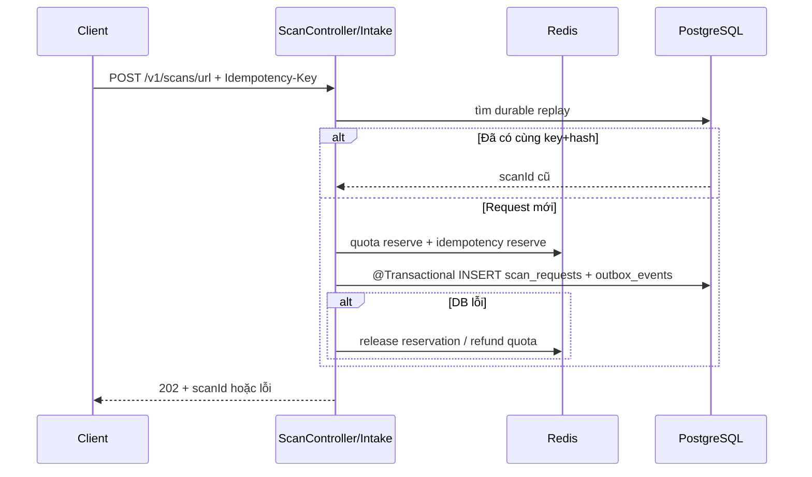

# CORE-01 · Scan Intake & Async Lifecycle Foundation (W10) — Báo cáo tính năng

> **BẢN NHÁP TIẾN ĐỘ — CHƯA DÙNG ĐỂ XÁC NHẬN ĐÃ ĐÓNG NHÓM TÍNH NĂNG.**
> Kiểm tra dựa trên snapshot `(6)` và báo cáo Agent 19/10; chưa có PR approval/merge hoặc fresh full suite sau follow-up.

## Thông tin chung

| Trường | Giá trị |
|---|---|
| **Mã nhóm tính năng** | `CORE-01` |
| **Tên nhóm** | Scan Intake & Async Lifecycle Foundation (W10) |
| **Người thực hiện** | Lê Trung Kiên |
| **Người review chéo** | Hùng (theo phân công W10/W11); **chưa có approval evidence** |
| **Thành phần** | `api`, `infra`, `contracts` |
| **Tuần / Sprint** | W10 · MVP |
| **Mốc kiến trúc** | Architecture V3.3; Modules V1.3; Schema V1.0 |
| **Pull Request** | **Chưa có URL/ID PR được xác minh** |
| **Commit chính** | **Chưa xác minh SHA; source ZIP chứa WIP** |
| **Trạng thái** | ☒ Đang làm · ☐ Chờ review · ☐ Đã merge · ☐ Đã nghiệm thu |
| **Ngày tổng hợp** | 2026-10-19 |

---

## 1. Tóm tắt trong 30 giây

- **Tôi đã làm gì:** Nối HTTP intake URL/TEXT/ENTITY/QR với W09 contract, persistence PostgreSQL, durable idempotency, quota policy, outbox và scan lifecycle.
- **Ai dùng được ngay:** Khải/Thắng triển khai Worker theo queue routing; Hùng review access/entitlement; frontend gửi POST lấy `scanId`.
- **Chạy thử nhanh nhất:** `python3 scripts/ci-runtime-smoke.py` (cần Docker và môi trường local; script sẽ khởi động hạ tầng kiểm thử riêng).

## 2. Phạm vi đã làm

### 2.1. Đã triển khai (không đồng nghĩa đủ DoD)

| Ưu tiên | Chức năng | Bằng chứng ở source `(6)` |
|---|---|---|
| P0 | HTTP intake 4 scan types | `scan/api/ScanController.java` + OpenAPI |
| P0 | Persist scan và outbox atomically | `ScanPersistenceService.java`, `V4__scan_lifecycle_outbox.sql` |
| P0 | Durable replay, conflict, PG race winner | `JdbcScanRequestRepository.java`, `ScanPersistenceHardeningTest.java` |
| P0 | Quota Redis fail-closed | `RedisQuotaGate.java`, CI runtime smoke (theo Agent) |
| P0 | AES-GCM và redact display | `scan/privacy/AesGcmPayloadProtector.java`, `ScanPayloadProtectionTest.java` |
| P0 | Lifecycle state + deadline | `ScanLifecycleService.java`, `ScanDeadlineRecovery.java` (deadline phát triển tiếp ở W11) |

### 2.2. Chưa làm — và vì sao

| Ưu tiên | Còn thiếu | Lý do / xử lý |
|---|---|---|
| P0 | Quota reservation theo token cố định bucket, refund idempotent | Hiện `RedisQuotaGate.refund()` tái tính bucket; cần sửa và integration tests |
| P0 | Concurrency same-key theo quota count thực | Test hiện có DB winner/logic, chưa chứng minh mọi race/refund an toàn |
| P1 | Review chéo và merge | Chưa có approval/CI trạng thái PR được chứng minh |
| P1 | Guest issuer/entitlement resolver production | Dependency Hùng; W10 vẫn có seam và test domain |

## 3. Hợp đồng API

### 3.1. Endpoint

| Method | Path | Quyền | Vai trò |
|---|---|---|---|
| POST | `/v1/scans/url` | User đã xác thực / Guest context đáng tin cậy | URL scan |
| POST | `/v1/scans/text` | Như trên | TEXT scan |
| POST | `/v1/scans/entity` | Như trên | PHONE/BANK_ACCOUNT qua `entityType` |
| POST | `/v1/scans/qr` | Như trên | QR scan |

### 3.2. Ví dụ contract (minh họa từ source)

```http
POST /v1/scans/url
Idempotency-Key: <unique-key>
Content-Type: application/json
Authorization: Bearer <valid-access-token>

{"url":"https://example.com","source":"USER_INPUT"}
```

HTTP `202` và response dạng `{"success":true,"data":{"accepted":true,"replayed":false,"scanId":"<uuid>"}}`. Retry cùng key và body có thể trả `replayed=true` cùng `scanId`; key cũ nhưng body khác phải từ chối conflict. Các HTTP error code chính xác xem `contracts/openapi/anti-scam-api.yaml` và `ErrorCode.java` trước UAT. **Không coi `202` là RiskResult.**

### 3.3. Contract update

- [x] Có route/schema trong `contracts/openapi/anti-scam-api.yaml` (kiểm tra lại khi review)
- [ ] Xác nhận client types được sinh/đồng bộ nếu frontend dùng generator
- [ ] Xác nhận đã thông báo nhóm về field `scanId`/idempotency

## 4. Mô hình dữ liệu

| Bảng | Migration | Mục đích |
|---|---|---|
| `scan_requests` | `V4__scan_lifecycle_outbox.sql` | Owner, status, fingerprint, deadline, encrypted payload |
| `outbox_events` | `V4__scan_lifecycle_outbox.sql`; V5 bổ sung CLAIMED | Job publish intent, trạng thái publish, retry |

**Redis:** idempotency `scan:idempotency:*` (TTL), quota `scan:quota:<actor>:<subject>:<bucket>` (fixed window). Redis key/quota limit phải khớp cấu hình runtime; quota `DECR` hiện chưa có reservation token. Index/constraint tra trực tiếp V4, nhất là unique `(idempotency_scope,idempotency_key)`.

**Migration smoke:** Agent từng chạy PostgreSQL/Flyway thực; sau follow-up `(6)` cần rerun và lưu output CI. Không chỉnh migration V4 đã áp dụng.

## 5. Luồng xử lý



**Bước khó:** PostgreSQL transaction không bao phủ Redis. `ON CONFLICT` ngăn duplicate row/outbox, nhưng quota cần recovery riêng cho rollback, race và chuyển bucket.

## 6. Cấu trúc mã nguồn

| File (tương đối từ `services/api/src/main/java/com/antiscam/api/`) | Trách nhiệm |
|---|---|
| `scan/api/ScanController.java` | HTTP binding, response 202 |
| `scan/application/ScanIntakeService.java` | Admission, quota, idempotency, routing |
| `scan/application/ScanPersistenceService.java` | Durable scan/outbox transaction |
| `scan/application/RedisQuotaGate.java` | Redis window quota (đang nợ tokenized release) |
| `scan/idempotency/RedisIdempotencyStore.java` | Lua NEW/REPLAY/CONFLICT |
| `scan/persistence/JdbcScanRequestRepository.java` | PG `ON CONFLICT` durable winner |
| `scan/privacy/AesGcmPayloadProtector.java` | Bảo vệ payload nhạy cảm |
| `scan/application/ScanLifecycleService.java` | Guard transitions |

**Điểm vào để đọc code:** `scan/api/ScanController.java` → `scan/application/ScanIntakeService.java` → `ScanPersistenceService.java`.

## 7. Quyết định kỹ thuật và đánh đổi

| Quyết định | Phương án | Lý do | Đánh đổi |
|---|---|---|---|
| PostgreSQL là nguồn dữ liệu scan chính | Redis-only vs PG durable | Replay ổn định sau crash | Cần phối hợp Redis reservation/quota |
| Transactional Outbox | Publish trong HTTP vs lưu intent cùng scan | Tránh mất job do DB commit nhưng publish thất bại | Publisher/retry ở W11, at-least-once |
| AES-GCM + mask display | Lưu plain text vs encrypted bytes | Giảm lộ PII trong DB/log | Quản lý/rotation key deployment |
| Typed W09 command | DTO riêng cho từng module vs common command | Team dùng chung contract | Cần giữ backward compatibility |

## 8. Cấu hình và biến môi trường

| Biến | Bắt buộc | Nguồn / ghi chú |
|---|---|---|
| `POSTGRES_PASSWORD`, `DB_URL`, `DB_USER`, `DB_PASSWORD` | Khi chạy DB | `.env` local; Compose phải đọc đúng `--env-file .env` |
| `REDIS_HOST`, `REDIS_PORT` | Khi chạy Redis | `application.yml` hoặc environment |
| `JWT_SECRET`, `OTP_HASH_SECRET` | Cho API auth | Secret thực tế, không commit |
| `SCAN_PAYLOAD_ENCRYPTION_KEY` | Khi bật encrypted scan persistence | Key triển khai; **không đưa vào báo cáo/commit** |
| `GUEST_PROOF_SECRET` | Với guest proof | Phối hợp Hùng; không hardcode |

Tên và yêu cầu cụ thể đối chiếu `.env.example`, `application.yml`, `ScanConfiguration.java` trước deploy; chưa xác nhận secret production được cấu hình.

## 9. Bảo mật và quyền riêng tư

| Rủi ro | Cơ chế | Kiểm chứng |
|---|---|---|
| Lộ URL/text/PHONE/BANK trong display/outbox | Mask trong `ScanPersistenceService`, ciphertext AES-GCM | `ScanPayloadProtectionTest` |
| Duplicate scans/quota | Actor-scoped key, unique constraint, Lua Redis | `ScanPersistenceHardeningTest`, cần thêm bucket-boundary test |
| Redis unavailable | Fail-closed quota | Agent runtime smoke |

Dữ liệu nhạy cảm: URL, TEXT, số điện thoại, số tài khoản, guest proof hash. Không khẳng định mọi nhánh logging đã được audit đầy đủ.

## 10. Kiểm thử

### 10.1. Cách chạy

```bash
cd services/api && ./mvnw -B test
cd ../..
python3 -m unittest discover -s contracts/tests -v
python3 scripts/ci-runtime-smoke.py
```

### 10.2. Test đã có

| Case | Evidence | Trạng thái |
|---|---|---|
| Typed route/quota denial | `ScanRoutingContractTest`, `ScanAccessGateTest` | Unit/contract có |
| Durable PG replay + rollback | `ScanPersistenceHardeningTest`, smoke script | Có; cần cross-window quota test |
| AES-GCM masking | `ScanPayloadProtectionTest` | Có |
| Migration/HTTP acceptance | `scripts/ci-runtime-smoke.py` | PASS theo Agent run 19/10 trước follow-up |

**Số liệu:** Agent báo 155 Maven tests + 21 Python contract PASS trước follow-up; Agent follow-up báo focused 11 PASS. **Không có fresh full-suite exit code cho snapshot `(6)`**. Không có coverage % xác minh và chưa có CI URL.

## 11. Cách chạy thử / demo

```bash
cd ~/Documents/hcmus/KLTN-2023-HCMUS/Scam-Risk-Detector
# Dựng Docker local và sử dụng lệnh kiểm thử tái lập (test-only secrets tạo trong script).
python3 scripts/ci-runtime-smoke.py
```

**Kỳ vọng:** `POST` trả scanId bền vững; replay giữ scanId; DB chứa đúng một scan/outbox cho cùng idempotency intent. Nếu chạy thủ công bằng `curl`, dùng tài khoản/JWT hợp lệ hoặc guest context theo contract, không tự đặt header guest giả.

## 12. Ảnh hưởng tới người khác

| Thay đổi | Ai | Việc phối hợp |
|---|---|---|
| POST API plural + scanId | Thắng và nhóm Web/Mobile | Dùng namespace `/v1/scans/`, retry giữ nguyên key |
| Queue/routing and outbox | Khải/Thắng Worker | Đồng bộ schema/events, không bypass outbox |
| Access/Guest entitlement | Hùng | Kiểm tra chính sách và proof issuer/resolver |
| DB migration | Team backend | Tránh chỉnh V4 đã apply |

**Đã báo người liên quan chưa:** Chưa có chứng cứ xác nhận trong tài liệu được cung cấp; cần ghi nhận khi bàn giao.

## 13. Hạn chế đã biết và việc còn nợ

| # | Hạn chế | Ảnh hưởng | Hướng xử lý |
|---|---|---|---|
| 1 | Quota refund không token hóa theo bucket | Refund lệch khi qua window, double refund | Token-based reserve/release, integration tests |
| 2 | Guest issuer/HTTP E2E chưa khép kín | Guest user journey chưa nghiệm thu | Hùng handoff proof + HTTP matrix |
| 3 | Đã có code nhưng chưa merge/approval | Chưa đạt DoD nhóm | Draft PR + CI + peer review |

## 14. Nhật ký thay đổi

| Ngày | Phiên bản | Thay đổi | PR |
|---|---|---|---|
| 15/10/2026 | W10 initial | ScanRequest, V4, lifecycle, status | Chưa cung cấp |
| 19/10/2026 | Hardening | DB winner, encryption, Redis outage recovery, tests | Chưa cung cấp |
| 19/10/2026 | Follow-up `(6)` | Refund replay DB race; còn K1 cross-window | Chưa cung cấp |

*Người viết: Lê Trung Kiên · Tổng hợp: 2026-10-19 · Người review dự kiến: Hùng · Mẫu: BCTN v1.0*
