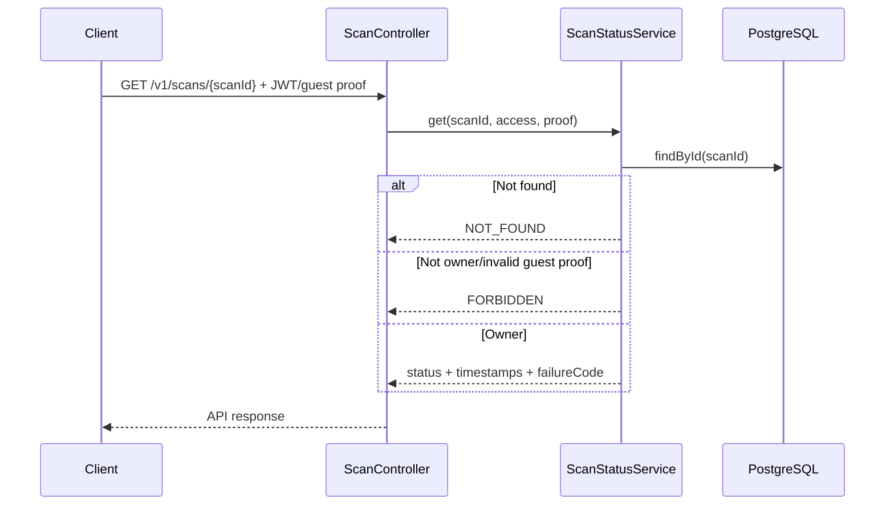

# R01 · Theo dõi trạng thái Scan — G2 (W10) — Báo cáo tính năng

> **BẢN NHÁP TIẾN ĐỘ — CHƯA DÙNG ĐỂ XÁC NHẬN ĐÃ ĐÓNG NHÓM TÍNH NĂNG.**
> Kiểm tra dựa trên snapshot `(6)` và báo cáo Agent 19/10; chưa có PR approval/merge hoặc fresh full suite sau follow-up.

## Thông tin chung

| Trường | Giá trị |
|---|---|
| **Mã nhóm tính năng** | `R01` |
| **Tên nhóm** | Theo dõi trạng thái Scan — G2 (W10) |
| **Người thực hiện** | Lê Trung Kiên |
| **Người review chéo** | Hùng (theo phân công W10/W11); **chưa có approval evidence** |
| **Thành phần** | `api`, `infra`, `contracts` |
| **Tuần / Sprint** | W10 · MVP |
| **Mốc kiến trúc** | Architecture V3.3; Modules V1.3; Schema V1.0 |
| **Pull Request** | **Chưa có URL/ID PR được xác minh** |
| **Commit chính** | **Chưa xác minh SHA; source ZIP chứa WIP** |
| **Trạng thái** | ☒ Đang làm · ☐ Chờ review · ☐ Đã merge · ☐ Đã nghiệm thu |
| **Ngày tổng hợp** | 2026-10-19 |

---

## 1. Tóm tắt trong 30 giây

- **Tôi đã làm gì:** Cung cấp `GET /v1/scans/{scanId}` đọc PostgreSQL và chặn user/guest không sở hữu scan.
- **Ai dùng được ngay:** Thắng làm polling UI; Hùng kiểm tra guest proof issuance/authorization policy.
- **Chạy thử nhanh:** `python3 scripts/ci-runtime-smoke.py` (case authenticated ownership/IDOR); guest-proof HTTP E2E còn nợ.

## 2. Phạm vi đã làm

### 2.1. Đã triển khai (không đồng nghĩa đủ DoD)

| Ưu tiên | Chức năng | Bằng chứng |
|---|---|---|
| P0 | GET status, status/timestamps/failureCode | `ScanController.java`, `ScanStatusResponse.java` |
| P0 | Đọc trạng thái DB | `ScanStatusService.java`, `JdbcScanRequestRepository.java` |
| P0 | Authenticated owner/IDOR | `ScanStatusService.authorized`, `ScanW10DomainTest`, smoke script |
| P0 | Guest proof domain verifier, expiry/hash | `GuestProofVerifier.java`, `ScanAccessProof.java` |
| P0 | Lifecycle terminal immutable | `ScanLifecycleService.java` + test domain |

### 2.2. Chưa làm — và vì sao

| Ưu tiên | Chưa làm | Lý do |
|---|---|---|
| P1 | Guest POST/GET HTTP end-to-end theo issuer thật | Phụ thuộc Hùng; domain tests chưa thay integration |
| P1 | Manual frontend polling UAT | Phối hợp Thắng W11 |
| P1 | Reviewer approve và merge | Chưa có URL/approval/CI green được cung cấp |

## 3. Hợp đồng API

| Method | Path | Auth | Response |
|---|---|---|---|
| GET | `/v1/scans/{scanId}` | JWT chủ sở hữu hoặc guest proof hợp lệ | `{scanId,status,requestedAt,startedAt,completedAt,failureCode}` trong `{success:true,data:{...}}` |

**Ví dụ:**

```bash
curl -H "Authorization: Bearer $ACCESS_TOKEN"   http://localhost:8080/v1/scans/$SCAN_ID
```

Mã nghiệp vụ khi không tìm được scan: `NOT_FOUND`; owner khác: `FORBIDDEN`. Không đưa `input_payload_ciphertext`, text/URL hoặc idempotency hash ra status response.

**Contract:** `contracts/openapi/anti-scam-api.yaml` mô tả GET và shape status; xác nhận frontend không dùng singular `/v1/scan/{scanId}`.

## 4. Mô hình dữ liệu

R01 dùng bảng `scan_requests` của V4, không tạo bảng trạng thái riêng. Cột liên quan: `id`, `owner_user_id`, `guest_access_hash`, `status`, `requested_at`, `started_at`, `completed_at`, `failure_code`. `scanId` không phải bearer token.

## 5. Luồng xử lý



**Vì sao:** `scanId` là locator, không phải quyền truy cập; access phải lấy từ principal/trusted proof, không lấy user ID do client tự ghi.

## 6. Cấu trúc mã nguồn

| File | Trách nhiệm |
|---|---|
| `scan/api/ScanController.java` | HTTP GET, xử lý principal / guest |
| `scan/api/ScanStatusResponse.java` | DTO trả dữ liệu an toàn |
| `scan/application/ScanStatusService.java` | Truy vấn status và ownership |
| `scan/access/GuestProofVerifier.java` | Kiểm chứng guest proof |
| `scan/application/ScanLifecycleService.java` | State transitions |
| `scan/persistence/JdbcScanRequestRepository.java` | Truy vấn status từ PostgreSQL |

**Điểm vào để đọc code:** `scan/api/ScanController.get()` → `scan/application/ScanStatusService.get()`.

## 7. Quyết định kỹ thuật và đánh đổi

| Quyết định | Phương án | Vì sao | Đánh đổi |
|---|---|---|---|
| Đọc status trực tiếp từ PG | Cache-only vs durable read | State nguồn-sự-thật, tránh UI đọc sai | DB load khi polling cao |
| Quyền sở hữu kiểm tra server-side | `scanId` as token vs identity/proof | Tránh IDOR | Cần guest proof issuer và rotation policy |
| Response sanitize | Trả raw record vs projection | Giảm lộ dữ liệu nhạy cảm | Result detail cần API riêng sau |

## 8. Cấu hình và biến môi trường

| Biến | Mục đích |
|---|---|
| `GUEST_PROOF_SECRET` | HMAC verification (cần issuer từ Hùng) |
| JWT auth config | Authenticated principal |
| `DB_URL`/`DB_USER`/`DB_PASSWORD` | Đọc status PG |

Không in secret và không phát minh mẫu guest proof hợp lệ.

## 9. Bảo mật và quyền riêng tư

| Rủi ro | Kiểm soát | Test |
|---|---|---|
| IDOR qua scanId | So sánh `ownerUserId` hoặc guest proof hash | `ScanW10DomainTest`, authenticated runtime smoke |
| Lộ raw payload qua status | Projection `ScanStatusResponse` | Domain/source inspection |
| Guest proof hết hạn/giả | HMAC, expiry, hash | Domain tests; HTTP E2E chưa đủ |

Guest issuer bên ngoài chưa xác minh production, không thể coi Guest UAT đã hoàn tất.

## 10. Kiểm thử

```bash
cd services/api && ./mvnw -B -Dtest=ScanW10DomainTest test
cd ../..
python3 scripts/ci-runtime-smoke.py
```

Đã có authenticated owner/IDOR test và domain guest expiry theo source. Chưa có bằng chứng end-to-end Guest POST/GET thật và manual browser UAT. Full Maven 155/155 PASS là **Agent báo cáo trước follow-up**, cần rerun tại commit nghiệm thu.

## 11. Cách chạy thử / demo

**Cách demo:** Khởi chạy API/PG + JWT hợp lệ, POST URL nhận `scanId`, GET cùng JWT trả PENDING/PROCESSING hoặc terminal, GET bằng JWT user khác bị từ chối.

```bash
curl -fsS "http://localhost:8080/v1/scans/$SCAN_ID"   -H "Authorization: Bearer $ACCESS_TOKEN"
```

Dùng `$SCAN_ID` thật từ API response, không hardcode UUID hoặc JWT trong tài liệu.

## 12. Ảnh hưởng tới người khác

| Ai | Ảnh hưởng | Hành động |
|---|---|---|
| Thắng | Render polling status/failure | Dùng OpenAPI response, xử lý các terminal state |
| Hùng | Guest proof issuer | Thống nhất ký/verify/TTL và negative tests |
| Khải | Job result lifecycle | Không tự thay đổi status từ Worker ngoài contract |

**Đã báo người liên quan chưa:** Chưa có chứng cứ xác nhận trong tài liệu được cung cấp; cần ghi nhận khi bàn giao.

## 13. Hạn chế đã biết và việc còn nợ

| # | Hạn chế | Ảnh hưởng | Xử lý |
|---|---|---|---|
| 1 | Guest proof HTTP E2E thiếu | Chưa kết luận Guest flow production-ready | Test issuer thật cùng Hùng |
| 2 | HTTP polling với Worker thật chưa chạy | Chưa chứng minh G3 | W11 phối hợp Khải/Thắng |
| 3 | Chưa được approve/merge | Không đạt DoD nhóm | Draft PR + peer review |

## 14. Nhật ký thay đổi

| Ngày | Thay đổi | PR |
|---|---|---|
| 15/10/2026 | GET status, service, ownership, guest proof boundary | Chưa cung cấp |
| 19/10/2026 | Authenticated IDOR smoke theo Agent | Chưa cung cấp |

*Người viết: Lê Trung Kiên · Tổng hợp: 2026-10-19 · Người review dự kiến: Hùng · Mẫu: BCTN v1.0*
