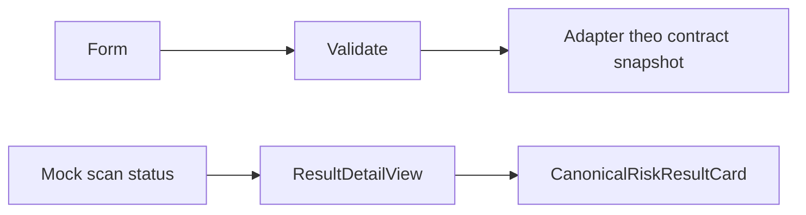

# T-MVP02 · Result UI và Text Scan Foundation (R02/S02) — Báo cáo tính năng

## Thông tin chung

| Trường | Giá trị |
|---|---|
| Mã nhóm tính năng | T-MVP02 |
| Tên nhóm | Result UI và Text Scan Foundation (R02/S02) |
| Người thực hiện | Thắng |
| Người review chéo | Kiên theo phân công; không thay xác nhận cá nhân |
| Thành phần | Web / Core / Worker theo phạm vi bên dưới |
| Tuần / Sprint | W10 · 06/10–12/10/2026; Sprint chưa xác nhận |
| Mốc kiến trúc | V3.3; không suy ra quyết định nhóm đã approve |
| Pull Request / Commit | Bảng truy vết ở dưới |
| Trạng thái | Báo cáo bổ sung hồi cứu; trạng thái code theo từng PR, chưa nhận nghiệm thu |
| Ngày nộp báo cáo | Soạn 29/10/2026; chờ review PR tài liệu |

---

## 1. Tóm tắt trong 30 giây

- **Tôi đã làm gì:** ResultDetailView với risky/low-risk/no-data/degraded fixtures; form MESSAGE/TRANSACTION_POST, validation và adapter intake. Đối chiếu T-MVP02 nhưng không nhận toàn bộ History/Export của timeline đã xong ở snapshot W10.
- **Ai dùng ngay:** các thành viên đọc contract/runbook để tích hợp hoặc review theo phạm vi.
- **Chạy thử nhanh nhất:** xem mục 11; fixture không thay E2E.

---

## 2. Phạm vi đã làm

### 2.1. Đã hoàn thành ở mức có bằng chứng

| Ưu tiên | Tính năng | Bằng chứng |
|---|---|---|
| P0/P1 theo task | Hiển thị score/evidence/explanation/recommendation từ canonical payload. | [Spec triển khai](https://github.com/KLTN-2023-HCMSU/Scam-Risk-Detector/blob/0fe194976260bba5b7d82553ee0d51a5b644fa7c/docs/specs/R02_result_detail_W10.md) · [Hồ sơ kiểm chứng](https://github.com/KLTN-2023-HCMSU/Scam-Risk-Detector/blob/0fe194976260bba5b7d82553ee0d51a5b644fa7c/docs/specs/S02_text_scan_foundation_W10.md) |
| P0/P1 theo task | Có loading, failed, unavailable, no-data và malformed-result states. | [Spec triển khai](https://github.com/KLTN-2023-HCMSU/Scam-Risk-Detector/blob/0fe194976260bba5b7d82553ee0d51a5b644fa7c/docs/specs/R02_result_detail_W10.md) · [Hồ sơ kiểm chứng](https://github.com/KLTN-2023-HCMSU/Scam-Risk-Detector/blob/0fe194976260bba5b7d82553ee0d51a5b644fa7c/docs/specs/S02_text_scan_foundation_W10.md) |
| P0/P1 theo task | Form text validate nội dung và chọn contentType; không tự tạo verdict hoặc scanId khi receipt chưa có. | [Spec triển khai](https://github.com/KLTN-2023-HCMSU/Scam-Risk-Detector/blob/0fe194976260bba5b7d82553ee0d51a5b644fa7c/docs/specs/R02_result_detail_W10.md) · [Hồ sơ kiểm chứng](https://github.com/KLTN-2023-HCMSU/Scam-Risk-Detector/blob/0fe194976260bba5b7d82553ee0d51a5b644fa7c/docs/specs/S02_text_scan_foundation_W10.md) |

### 2.2. Chưa hoàn tất / không thuộc snapshot

Snapshot W10 là foundation/fixture. API result ownership, polling, History và Export đầy đủ được tích hợp tiếp ở các PR sau; không dùng kết quả W12 để nhận W10 đã hoàn thành E2E.

[Task tuần](../../../tasks/W10/Thang.md)

---

## 3. Hợp đồng API

UI demo /demo/scan-status và /demo/result/[scanId] dùng fixture. Route /scans/[scanId]/result lúc W10 còn unavailable. POST /v1/scans/text đi qua adapter theo contract intake của snapshot; receipt không đồng nghĩa completed result.

**Input minh họa, không có dữ liệu người dùng thật:**

```json
{"text":"Noi dung thu nghiem","contentType":"MESSAGE"}
```

**Output/đường lỗi:** 202/dispatch receipt nếu endpoint đã cấu hình và chấp nhận; không suy ra có scanId hoặc RiskResult khi contract receipt chưa cung cấp. Validation/quyền/phụ thuộc phải đọc theo OpenAPI của đúng snapshot, không suy từ ví dụ thành contract mới.

[OpenAPI hiện tại](https://github.com/KLTN-2023-HCMSU/Scam-Risk-Detector/blob/0fe194976260bba5b7d82553ee0d51a5b644fa7c/contracts/openapi/anti-scam-api.yaml); đối chiếu spec lịch sử nếu chạy PR cũ.

---

## 4. Mô hình dữ liệu

Không thêm migration cho phần UI/form W10; không cache hay lưu raw text vào browser storage.

---

## 5. Luồng xử lý



Nhánh lỗi và giới hạn: Snapshot W10 là foundation/fixture. API result ownership, polling, History và Export đầy đủ được tích hợp tiếp ở các PR sau; không dùng kết quả W12 để nhận W10 đã hoàn thành E2E.

---

## 6. Cấu trúc mã nguồn

| Điểm vào / File | Trách nhiệm |
|---|---|
| [apps/web/src/components/risk/ResultDetailView.tsx](https://github.com/KLTN-2023-HCMSU/Scam-Risk-Detector/blob/0fe194976260bba5b7d82553ee0d51a5b644fa7c/apps/web/src/components/risk/ResultDetailView.tsx) | Chọn loading/error/no-data/completed; validate canonical payload trước khi hiện card |
| [apps/web/src/components/scan/TextScanForm.tsx](https://github.com/KLTN-2023-HCMSU/Scam-Risk-Detector/blob/0fe194976260bba5b7d82553ee0d51a5b644fa7c/apps/web/src/components/scan/TextScanForm.tsx) | Form contentType, kiểm tra input và phản hồi trạng thái gửi |
| [docs/specs/S02_text_scan_foundation_W10.md](https://github.com/KLTN-2023-HCMSU/Scam-Risk-Detector/blob/0fe194976260bba5b7d82553ee0d51a5b644fa7c/docs/specs/S02_text_scan_foundation_W10.md) | Phạm vi foundation/adapter và bằng chứng W10 |

Link code ở báo cáo này ghim tại `0fe194976260` để không thay đổi âm thầm. Spec lịch sử ghi snapshot cũ riêng; không nhận file hiện tại đã tồn tại nguyên trạng tại mọi tuần.

---

## 7. Quyết định kỹ thuật và đánh đổi

Dùng discriminated UI state và runtime validation, tách seam fixture khỏi API chưa được bàn giao; đổi lại chưa thể gọi đây là result E2E.

Không có biên bản bổ sung phê duyệt DEC của cả nhóm/giảng viên; chỉ ghi lý do implementation và yêu cầu owner đã có. Xem nguồn kiến trúc thay vì tạo bản sao business rules.

---

## 8. Cấu hình và biến môi trường

NEXT_PUBLIC_API_URL/TEXT_SCAN_API_ENDPOINT theo snapshot triển khai; không hardcode host, userId hay access proof. Form foundation và adapter intake phải đọc đúng spec giới hạn tương ứng.

Cài dependency theo Maven wrapper/npm lockfile/requirements của repo code. Không chép .env, token, key hoặc thông tin đăng nhập vào document.

---

## 9. Bảo mật và quyền riêng tư

| Rủi ro | Xử lý / giới hạn |
|---|---|
| Nội dung riêng tư | Không log raw text/định danh/token; dùng dữ liệu thử có kiểm soát |
| Worker vượt quyền | Worker trả facts/signals, Core quyết định score/owner/lifecycle |
| UI/XSS và kết luận an toàn | Text binding, không suy ra SAFE khi thiếu verdict; phạm vi kiểm thử theo BCKT |

[Business Rules chuẩn](https://github.com/KLTN-2023-HCMSU/Scam-Risk-Detector/blob/0fe194976260bba5b7d82553ee0d51a5b644fa7c/docs/business-rules.md)

---

## 10. Kiểm thử

R02 spec ghi 97/97 web tests ở lượt xác minh 13/10; scope fixture/UI. PR #12 và #13 đã merge ngày 20/10. Không lấy ngày merge làm ngày Thắng hoàn thành code hoặc nhận xong đúng hạn.

[Báo cáo kiểm thử theo Template 04](BCKT_T-MVP02_Result_UI_Text_Foundation_Thang.md) · [Spec triển khai](https://github.com/KLTN-2023-HCMSU/Scam-Risk-Detector/blob/0fe194976260bba5b7d82553ee0d51a5b644fa7c/docs/specs/R02_result_detail_W10.md) · [Hồ sơ kiểm chứng](https://github.com/KLTN-2023-HCMSU/Scam-Risk-Detector/blob/0fe194976260bba5b7d82553ee0d51a5b644fa7c/docs/specs/S02_text_scan_foundation_W10.md)

---

## 11. Cách chạy thử / demo

Tại checkout **repo code** phù hợp với PR/snapshot, không chạy lệnh ứng dụng trong repo document:

```bash
cd apps/web
npm ci
npm test
npm run lint
npm run typecheck
npm run build
```


Ảnh/fixture lịch sử không chứng minh mọi ca backend hoặc môi trường phát hành đang hoạt động.

---

## 12. Ảnh hưởng tới người khác

| Với ai | Nội dung cần bàn giao | Xác nhận |
|---|---|---|
| Kiên | Review contract/Core/quyền và kiểm thử chéo đúng snapshot | Chưa tự điền approve |
| Khải / nhóm runtime | Queue/schema/config/browser theo phần có ảnh hưởng | Xem handoff trong spec, chưa tự nhận đã thông báo |
| Nhóm / giảng viên | Phân biệt implemented, merged và accepted | Báo cáo này không phải biên bản nghiệm thu |

---

## 13. Hạn chế đã biết và việc còn nợ

Snapshot W10 là foundation/fixture. API result ownership, polling, History và Export đầy đủ được tích hợp tiếp ở các PR sau; không dùng kết quả W12 để nhận W10 đã hoàn thành E2E.

Chưa ghi nhận giờ làm thực tế, review cá nhân, thời điểm hoàn thành từng hạng mục hoặc chữ ký UAT. Không công bố accuracy/latency/F1 từ unit test.

---

## 14. Nhật ký thay đổi

| Ngày | Nội dung |
|---|---|
| 29/10/2026 | Bổ sung hồi cứu theo Template 01, không nhận đã nộp đúng hạn |

| PR | Trạng thái GitHub tại lúc kiểm tra | Thời điểm merge UTC | Head snapshot |
|---|---|---|---|
| [#12](https://github.com/KLTN-2023-HCMSU/Scam-Risk-Detector/pull/12) | MERGED | 2026-10-20T02:13:30Z | `6ac650ee1472` |
| [#13](https://github.com/KLTN-2023-HCMSU/Scam-Risk-Detector/pull/13) | MERGED | 2026-10-20T02:14:20Z | `38e3da966220` |

Ngày merge không phải ngày code hoàn thành. Báo cáo tuần không lấy trạng thái hiện tại gán ngược cho hạn cuối tuần.
