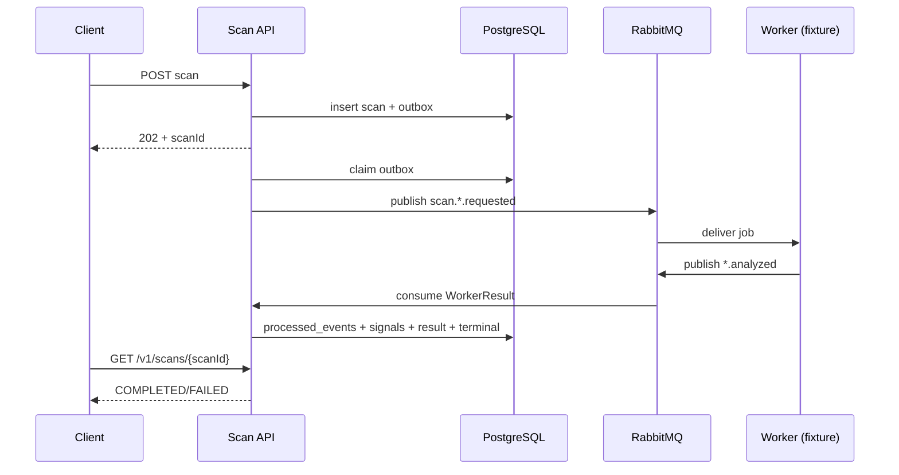

# CORE-01 · Async Scan Lifecycle & Risk Core Integration (W11) — Báo cáo tính năng

> **BẢN NHÁP TIẾN ĐỘ — CHƯA DÙNG ĐỂ XÁC NHẬN ĐÃ ĐÓNG NHÓM TÍNH NĂNG.**
> Kiểm tra dựa trên snapshot `(6)` và báo cáo Agent 19/10; chưa có PR approval/merge hoặc fresh full suite sau follow-up.

## Thông tin chung

| Trường | Giá trị |
|---|---|
| **Mã nhóm tính năng** | `CORE-01` |
| **Tên nhóm** | Async Scan Lifecycle & Risk Core Integration (W11) |
| **Người thực hiện** | Lê Trung Kiên |
| **Người review chéo** | Hùng (theo phân công W10/W11); **chưa có approval evidence** |
| **Thành phần** | `api`, `infra`, `contracts` |
| **Tuần / Sprint** | W11 · MVP |
| **Mốc kiến trúc** | Architecture V3.3; Modules V1.3; Schema V1.0 |
| **Pull Request** | **Chưa có URL/ID PR được xác minh** |
| **Commit chính** | **Chưa xác minh SHA; source ZIP chứa WIP** |
| **Trạng thái** | ☒ Đang làm · ☐ Chờ review · ☐ Đã merge · ☐ Đã nghiệm thu |
| **Ngày tổng hợp** | 2026-10-19 |

---

## 1. Tóm tắt trong 30 giây

- **Tôi đã làm gì:** Có producer outbox → RabbitMQ → worker-result consumer → `scan_signals`/`scan_results` và deadline recovery; test URL với contract fixture.
- **Ai dùng được ngay:** Khải/Thắng có thể đối chiếu message fixtures; frontend có thể polling R01; tuy nhiên **chưa đủ điều kiện công bố pipeline production G3**.
- **Chạy thử nhanh:** `python3 scripts/ci-runtime-smoke.py` (Docker/test-only worker; phải chạy lại sau latest changes).

## 2. Phạm vi đã làm

### 2.1. Đã triển khai (không đồng nghĩa đủ DoD)

| Ưu tiên | Đã triển khai | Bằng chứng |
|---|---|---|
| P0 | Flyway V5 results/signals/inbox | `V5__scan_results_signals_inbox.sql` |
| P0 | Outbox claim/publish-confirm/retry | `scan/messaging/TransactionalOutboxPublisher.java` |
| P0 | Result listener/inbox event dedup | `RabbitScanMessagingConfiguration.java`, `WorkerResultConsumer.java` |
| P0 | Deterministic Risk Fusion baseline | `RiskFusionEvaluator.java` + unit tests |
| P0 | Deadline recovery | `ScanDeadlineRecovery.java` |
| P0 | RabbitMQ URL fixture roundtrip | `scripts/ci-runtime-smoke.py`, Agent completion report 19/10 |
| P1 | TEXT topology `q.scan.text` và binding | `RabbitScanMessagingConfiguration.java`; 1 focused topology test theo Agent follow-up |

### 2.2. Chưa làm — và vì sao

| Ưu tiên | Chưa làm / chưa kiểm chứng | Lý do |
|---|---|---|
| P0 | Result-vs-timeout atomic finalization | `WorkerResultConsumer` SELECT status trước INSERT, không kiểm affected rows cuối; có race |
| P0 | Không trả SAFE với mixed NO_DATA + LOW | Evaluator vẫn có thể trả `SAFE,degraded=true` |
| P0 | Active published rule set/fusion policy | Hiện hardcoded severity weights; chưa gắn policy version |
| P1 | Broker TEXT full roundtrip | Mới có queue/binding + unit test |
| P1 | URL/TEXT production Worker integration | Dependency Khải/Thắng; fixture không thay production |
| P1 | Outbox/inbox poison, claim lease/recovery full tests | Có baseline, chưa chứng minh mọi failure windows |
| P1 | Reviewer approval, merge | Chưa xác minh |

## 3. Hợp đồng API

**Public endpoints:** dùng lại `POST /v1/scans/{url,text,entity,qr}` và `GET /v1/scans/{scanId}` của W10; W11 không tự thêm endpoint RiskResult nếu chưa có OpenAPI được phê duyệt.

**Event boundary:** `scan.url.requested` → `q.scan.url`; `scan.text.requested` → `q.scan.text`; worker result `scan.url.analyzed`/`scan.text.analyzed` → `q.scan.result`. Message schema ở `contracts/events/`; validate bằng `contracts/validate_events.py`.

**Không suy luận RiskResult từ `202 Accepted`.** Status `COMPLETED` sau khi persisted result/terminal transition thành công.

## 4. Mô hình dữ liệu

| Bảng | Migration | Ghi chú |
|---|---|---|
| `scan_requests` | V4 | PENDING/PROCESSING/COMPLETED/FAILED, deadline |
| `outbox_events` | V4/V5 | PENDING/CLAIMED/PUBLISHED/FAILED |
| `scan_results` | V5 | 1:1 `scan_id`, score/level/degraded |
| `scan_signals` | V5 | Facts từ worker, unique `(scan_id, signal_key)` |
| `processed_events` | V5 | Dedupe `(consumer_key, event_id)` |

Tránh tự tạo bảng `risk_results` ngoài schema chuẩn. **V5 đã tồn tại**; mọi sửa schema tiếp theo dùng migration mới.

## 5. Luồng xử lý



**Không hiển nhiên:** RabbitMQ at-least-once nên cần inbox dedup. `scan_results` phải được ghi atomically với terminal status; bản `(6)` chưa chứng minh an toàn trước race timeout.

## 6. Cấu trúc mã nguồn

| File | Trách nhiệm |
|---|---|
| `scan/messaging/RabbitScanMessagingConfiguration.java` | Exchange, queues, bindings, listener |
| `scan/messaging/TransactionalOutboxPublisher.java` | Publish sau commit + retry |
| `scan/result/WorkerResultConsumer.java` | Nhận event và lưu inbox/results/signals |
| `scan/result/RiskFusionEvaluator.java` | Chấm điểm tạm theo severity |
| `scan/application/ScanDeadlineRecovery.java` | Fail scan quá deadline |
| `scan/privacy/AesGcmPayloadProtector.java` | Decrypt ở trust boundary |
| `scripts/ci-runtime-smoke.py` | Docker PG/Redis/Rabbit fixture end-to-end |

**Điểm vào để đọc code:** `scan/messaging/TransactionalOutboxPublisher.java` → `scan/result/WorkerResultConsumer.java`.

## 7. Quyết định kỹ thuật và đánh đổi

| Quyết định | Phương án | Vì sao | Đánh đổi |
|---|---|---|---|
| Transactional outbox | HTTP trực tiếp MQ vs PG outbox | DB commit không mất intent | Độ trễ, publisher retry |
| At-least-once + inbox | Giả định once vs dedup | Broker có thể giao trùng | Phải thiết kế idempotent consumer |
| Durable `scan_results` 1:1 | Lưu result trong scan row vs bảng riêng | Phù hợp Schema V1.0 | Transaction finalization phức tạp hơn |
| Degraded cho NO_DATA | Không dữ liệu→SAFE vs degraded | Tránh kết luận an toàn thiếu evidence | Cần chốt semantic policy, hiện chưa xong mixed case |

## 8. Cấu hình và biến môi trường

| Biến / cấu hình | Vai trò |
|---|---|
| `RABBITMQ_USER`, `RABBITMQ_PASSWORD` | Broker local/test credential |
| `SCAN_MESSAGING_ENABLED` hoặc property `app.scan.messaging.enabled` | Bật production RabbitMQ topology sau khi ready |
| `SCAN_PAYLOAD_ENCRYPTION_KEY` | Decrypt scan input khi publish job |
| PG/Redis/JWT config | Phụ thuộc CORE W10 |

Chỉ dùng tên biến đúng theo `.env.example` và `application.yml` của commit triển khai, không tự chế production secret. Runtime smoke tạo test-only secrets.

## 9. Bảo mật và quyền riêng tư

| Rủi ro | Cơ chế hiện có | Nợ kiểm chứng |
|---|---|---|
| Duplicate WorkerResult | Inbox `processed_events`, unique keys | Same eventId/different payload và redelivery/restart |
| Result đến sau timeout | Bỏ qua terminal state | Cần row lock/CAS để tránh race |
| Thiếu reputation | `degraded` flag | `NO_DATA + LOW` chưa chặn SAFE |
| Lộ input | AES-GCM và không lưu raw display | Review payload decrypted only at controlled boundary |

Không được kết luận production-safe chỉ vì smoke với fixture pass.

## 10. Kiểm thử

```bash
cd services/api && ./mvnw -B -Dtest=RiskFusionEvaluatorTest,RabbitScanMessagingConfigurationTest test
cd ../..
python3 -m unittest discover -s contracts/tests -v
python3 contracts/validate_events.py job contracts/events/fixtures/url-job.json
python3 scripts/ci-runtime-smoke.py
```

**Bằng chứng:** 155 Maven + 21 contract PASS theo Agent completion (trước follow-up); focused follow-up 11 PASS. `scripts/ci-runtime-smoke.py` từng PASS URL broker fixture; lần follow-up chạy lại bị lỗi transport, không có exit code. Chưa có TEXT full roundtrip/production Worker/UAT. Không có Precision, Recall, F1 hay test dataset đã gán nhãn.

## 11. Cách chạy thử / demo

```bash
cd ~/Documents/hcmus/KLTN-2023-HCMUS/Scam-Risk-Detector
python3 scripts/ci-runtime-smoke.py
```

**Kỳ vọng với fixture:** POST URL → RabbitMQ → fixture WorkerResult → `scan_results`/`scan_signals` → GET `COMPLETED`; duplicate event không sinh double result. Không claim đây là demo Worker production của Khải.

## 12. Ảnh hưởng tới người khác

| Ai | Ảnh hưởng | Cần làm gì |
|---|---|---|
| Khải | URL Worker + AMQP integration | Đồng bộ job/result schema, queue/bindings, smoke production |
| Thắng | Text Worker/Result UI (theo W11 task dependencies) | Đồng bộ `scan.text.*`, polling/Result UX |
| Hùng | Risk policy, Access/Entitlement, review | Duyệt degraded/threshold semantics, guest proof |
| Nhóm | Migration V5 | Không sửa lại V5 khi đã apply; kiểm tra DB bootstrap |

**Đã báo người liên quan chưa:** Chưa có chứng cứ xác nhận trong tài liệu được cung cấp; cần ghi nhận khi bàn giao.

## 13. Hạn chế đã biết và việc còn nợ

| # | Hạn chế | Tác động | Hướng xử lý |
|---|---|---|---|
| 1 | Result/timeout race | Có thể FAILED đồng thời có result | Row lock hoặc guarded CAS với affected-row assertion |
| 2 | Mixed NO_DATA+LOW→SAFE | Hiển thị mức an toàn sai | Regression tests + approved fail-safe policy |
| 3 | Scoring hardcode | Không khớp active rule version | Integrate ActiveRuleSetLoader/DSL được duyệt |
| 4 | Chưa có production Worker URL/TEXT | Chưa đạt real handoff | Integrate Khải/Thắng và review contract |

## 14. Nhật ký thay đổi

| Ngày | Bản | Thay đổi | PR |
|---|---|---|---|
| 19/10/2026 | Implementation | V5, outbox/inbox, URL fixture broker, AES-GCM | Chưa có ID |
| 19/10/2026 | Follow-up `(6)` | TEXT queue/bindings, Risk Fusion partial fixes | Chưa có ID |

*Người viết: Lê Trung Kiên · Tổng hợp: 2026-10-19 · Người review dự kiến: Hùng · Mẫu: BCTN v1.0*
