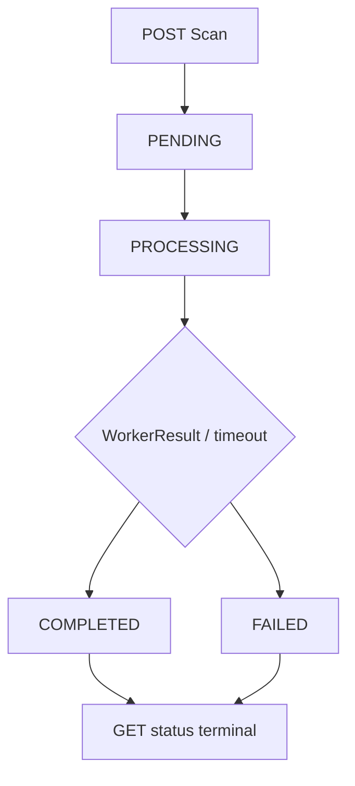

# R01 · Theo dõi trạng thái scan theo pipeline thật (W11) — Báo cáo tính năng

> **BẢN NHÁP TIẾN ĐỘ — CHƯA DÙNG ĐỂ XÁC NHẬN ĐÃ ĐÓNG NHÓM TÍNH NĂNG.**
> Kiểm tra dựa trên snapshot `(6)` và báo cáo Agent 19/10; chưa có PR approval/merge hoặc fresh full suite sau follow-up.

## Thông tin chung

| Trường | Giá trị |
|---|---|
| **Mã nhóm tính năng** | `R01` |
| **Tên nhóm** | Theo dõi trạng thái scan theo pipeline thật (W11) |
| **Người thực hiện** | Lê Trung Kiên |
| **Người review chéo** | Hùng (theo phân công W10/W11); **chưa có approval evidence** |
| **Thành phần** | `api`, `infra`, `contracts` |
| **Tuần / Sprint** | W11 · MVP |
| **Mốc kiến trúc** | Architecture V3.3; Modules V1.3; Schema V1.0 |
| **Pull Request** | **Chưa có URL/ID PR được xác minh** |
| **Commit chính** | **Chưa xác minh SHA; source ZIP chứa WIP** |
| **Trạng thái** | ☒ Đang làm · ☐ Chờ review · ☐ Đã merge · ☐ Đã nghiệm thu |
| **Ngày tổng hợp** | 2026-10-19 |

---

## 1. Tóm tắt trong 30 giây

- **Tôi đã làm gì:** Nối status API W10 với Scan Lifecycle lưu PostgreSQL sau WorkerResult; timeout chuyển FAILED, fixture worker có thể dẫn tới COMPLETED.
- **Ai dùng được:** Thắng tích hợp polling khi có flow production; Hùng review guest proof/IDOR.
- **Demo:** `python3 scripts/ci-runtime-smoke.py` (fixture; kết quả chưa thay cho browser/production UAT).

## 2. Phạm vi đã làm

### 2.1. Đã triển khai (không đồng nghĩa đủ DoD)

| Ưu tiên | Có trong source | Bằng chứng |
|---|---|---|
| P0 | GET status từ PostgreSQL | `ScanStatusService.java` |
| P0 | Owner/IDOR matrix | `scripts/ci-runtime-smoke.py`, Agent completion |
| P0 | COMPLETED sau WorkerResult fixture | `WorkerResultConsumer.java`, smoke script |
| P0 | FAILED/TIMEOUT sau deadline | `ScanDeadlineRecovery.java`, smoke script |
| P0 | Không overwrite terminal trong luồng tuần tự | Conditional UPDATE/terminal checks |

### 2.2. Chưa làm — và vì sao

| Ưu tiên | Nợ | Lý do |
|---|---|---|
| P0 | Race result cùng deadline | Cần transaction isolation / row lock/CAS đủ |
| P1 | Guest HTTP proof matrix | Chưa có production issuer handoff |
| P1 | Client polling UAT, result contract UI | Thắng chưa bàn giao evidence UAT |
| P1 | Real Worker G3 + reviewer | Fixture không thay production integration |

## 3. Hợp đồng API

| Method | Path | Response |
|---|---|---|
| GET | `/v1/scans/{scanId}` | `scanId`, `status`, `requestedAt`, `startedAt`, `completedAt`, `failureCode` |

**Giữ nguyên W10 OpenAPI**, không tự thêm trường riskScore vào status nếu chưa có approved schema. Polling dừng khi COMPLETED/FAILED; nếu scan không thuộc owner thì FORBIDDEN. Không trả raw signals vào status contract.

## 4. Mô hình dữ liệu

Nguồn status từ bảng `scan_requests` V4. V5 thêm `scan_results` và `scan_signals`; hai bảng này **không** được phép coi là final result hợp lệ nếu terminal transition chưa commit. Có `deadline_at`, `failure_code`, `completed_at`.

## 5. Luồng xử lý

**Điểm rủi ro:** `WorkerResultConsumer` đang ghi result rồi mới conditional UPDATE COMPLETED. Nếu deadline recovery thắng race, status FAILED vẫn có thể kèm result trong DB; cần kiểm chứng transaction finalization.

## 6. Cấu trúc mã nguồn

| File | Vai trò |
|---|---|
| `scan/application/ScanStatusService.java` | Read ownership-protected persisted status |
| `scan/api/ScanController.java` | GET entrypoint |
| `scan/result/WorkerResultConsumer.java` | Chuyển Processing/Completed khi result hợp lệ |
| `scan/application/ScanDeadlineRecovery.java` | Timeout → FAILED |
| `scan/api/ScanStatusResponse.java` | Status projection |

**Điểm vào để đọc code:** `scan/application/ScanStatusService.java` và `scan/result/WorkerResultConsumer.java`.

## 7. Quyết định kỹ thuật và đánh đổi

| Quyết định | Lý do | Đánh đổi |
|---|---|---|
| Poll persisted status, không fake lifecycle | Chống kết quả giả khi worker chưa hoàn thành | Poll DB load tăng |
| Terminal immutable | Chống late/duplicate overwrite | Cần row lock/CAS để đúng khi race |
| Separate Result vs Status | Không làm nặng GET polling | Client cần API result/flow khác theo contract |

## 8. Cấu hình và biến môi trường

Runtime như W10 R01 cộng `SCAN_MESSAGING_ENABLED`, broker credentials, encrypted payload key. Cần cấu hình theo `.env.example`/`application.yml`.

## 9. Bảo mật và quyền riêng tư

| Rủi ro | Cách giảm |
|---|---|
| IDOR | Service check JWT owner hoặc guest proof |
| Trả status giả | Đọc trạng thái từ PG |
| Race terminal | **Chưa hoàn tất**, cần concurrent integration test |

Không log raw input, không coi scanId là secret.

## 10. Kiểm thử

Chạy `./mvnw -B -Dtest=ScanW10DomainTest test` và `python3 scripts/ci-runtime-smoke.py` từ repo tương ứng. URL fixture COMPLETED/timeout/late IDOR PASS theo Agent completion 19/10; không có fresh broker run `(6)` và production UI polling. Chưa có metrics latency/UAT.

## 11. Cách chạy thử / demo

Chạy `python3 scripts/ci-runtime-smoke.py`; theo dõi từ POST, xử lý worker fixture, GET status. Kiểm chứng GET bằng JWT thứ hai bị từ chối. Với manual UI test cần Thắng thực hiện riêng và lưu ảnh/log.

## 12. Ảnh hưởng tới người khác

| Ai | Việc |
|---|---|
| Thắng | Polling và render terminal/error UX |
| Khải / Text owner | Event result chuẩn, failure/timeout semantics |
| Hùng | Guest proof issuer, security review |

**Đã báo người liên quan chưa:** Chưa có chứng cứ xác nhận trong tài liệu được cung cấp; cần ghi nhận khi bàn giao.

## 13. Hạn chế đã biết và việc còn nợ

| # | Còn thiếu | Tác động |
|---|---|---|
| 1 | Timeout-result race test/fix | G3 terminal consistency chưa đạt |
| 2 | Guest HTTP E2E | Guest UAT chưa xong |
| 3 | Worker production + UI UAT | Chỉ claim fixture evidence |

## 14. Nhật ký thay đổi

| Ngày | Thay đổi | PR |
|---|---|---|
| 19/10/2026 | Deadline recovery + URL fixture status | Chưa cung cấp |
| 19/10/2026 | Audit race chưa có CAS đầy đủ | Chưa cung cấp |

*Người viết: Lê Trung Kiên · Tổng hợp: 2026-10-19 · Người review dự kiến: Hùng · Mẫu: BCTN v1.0*
