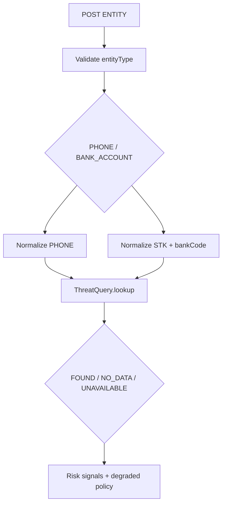

# S03/S04 · PHONE và BANK_ACCOUNT Reputation — Báo cáo tiến độ (W11) — Báo cáo tính năng

> **BẢN NHÁP TIẾN ĐỘ — CHƯA DÙNG ĐỂ XÁC NHẬN ĐÃ ĐÓNG NHÓM TÍNH NĂNG.**
> Kiểm tra dựa trên snapshot `(6)` và báo cáo Agent 19/10; chưa có PR approval/merge hoặc fresh full suite sau follow-up.

## Thông tin chung

| Trường | Giá trị |
|---|---|
| **Mã nhóm tính năng** | `S03/S04` |
| **Tên nhóm** | PHONE và BANK_ACCOUNT Reputation — Báo cáo tiến độ (W11) |
| **Người thực hiện** | Lê Trung Kiên |
| **Người review chéo** | Hùng (theo phân công W10/W11); **chưa có approval evidence** |
| **Thành phần** | `api`, `infra`, `contracts` |
| **Tuần / Sprint** | W11 · MVP |
| **Mốc kiến trúc** | Architecture V3.3; Modules V1.3; Schema V1.0 |
| **Pull Request** | **Chưa có URL/ID PR được xác minh** |
| **Commit chính** | **Chưa xác minh SHA; source ZIP chứa WIP** |
| **Trạng thái** | ☒ Đang làm · ☐ Chờ review · ☐ Đã merge · ☐ Đã nghiệm thu |
| **Ngày tổng hợp** | 2026-10-19 |

---

## 1. Tóm tắt trong 30 giây

- **Tôi đã làm gì:** Dùng chung `ENTITY` contract cho PHONE/BANK_ACCOUNT, validate/normalize, bắt buộc `bankCode` và giữ rõ ba trạng thái FOUND/NO_DATA/REPUTATION_UNAVAILABLE ở boundary.
- **Ai dùng:** Module reputation/data owner và UI entity scan có thể thống nhất contract, **chưa có provider production**.
- **Chạy thử:** `cd services/api && ./mvnw -B -Dtest=EntityContractTest test`.

## 2. Phạm vi đã làm

### 2.1. Đã triển khai (không đồng nghĩa đủ DoD)

| Mã | Đã có | Bằng chứng |
|---|---|---|
| S03 | PHONE normalize/validate | `EntityNormalizerRegistry.java`, `EntityContractTest.java` |
| S03 | ThreatQuery contract + mock | `threat/contract/ThreatQuery.java`, `MockThreatQuery.java` |
| S04 | BANK_ACCOUNT yêu cầu bankCode; namespace tách theo bank | `EntityNormalizerRegistry.java` |
| S03/S04 | ENTITY scan qua POST `/v1/scans/entity` | `ScanController.java`, `EntityScanPayload.java` |
| S03/S04 | NO_DATA != SAFE trong contract | `ThreatLookupResult.java`, `RiskFusionEvaluatorTest.java` (còn bug mixed-evidence) |

### 2.2. Chưa làm — và vì sao

| Mã | Còn thiếu | Vì sao |
|---|---|---|
| S03 | Provider reputation PHONE thật, evidence/source, outage semantics end-to-end | Chưa có nguồn được duyệt |
| S04 | Provider BANK theo cặp `(bankCode, normalizedAccount)` | Chưa có source production approved |
| S03/S04 | Deterministic Result từ threat lookup qua pipeline thật | Boundary có, Risk Fusion policy/rabbit still incomplete |
| S03/S04 | Reviewer approve và browser UAT | Chưa có evidence |

## 3. Hợp đồng API

| Method | Path | Ý nghĩa |
|---|---|---|
| POST | `/v1/scans/entity` | `entityType` nhận `PHONE` hoặc `BANK_ACCOUNT`; `value` là indicator; `bankCode` bắt buộc theo policy BANK |

```json
{"entityType":"BANK_ACCOUNT","value":"123456789","bankCode":"VCB"}
```

Đây là **request minh họa**, không phải một tài khoản bị xác nhận lừa đảo. Không tạo route `/v1/scans/bank` hoặc scan type riêng. `NO_DATA` nghĩa không thấy dữ liệu; `REPUTATION_UNAVAILABLE` nghĩa nguồn không truy cập được.

## 4. Mô hình dữ liệu

Không có bảng reputation production mới được chứng minh trong phần Kiên của snapshot `(6)`. Đã có contract cho normalized PHONE/BANK indicator, worker/risk dùng `scan_signals`/`scan_results` V5 nhưng đó không thay thế reputation datastore/provider.

## 5. Luồng xử lý



Bắt buộc phân biệt `NO_DATA` với `SAFE`, và khác outage của provider. Không tự gán cảnh báo lừa đảo nếu chỉ có fixture.

## 6. Cấu trúc mã nguồn

| File | Vai trò |
|---|---|
| `scan/contract/EntityScanPayload.java` | Entity payload / entity type |
| `scan/entity/EntityNormalizerRegistry.java` | Normalize và validate PHONE/BANK |
| `threat/contract/ThreatQuery.java` | Reputation port |
| `threat/contract/MockThreatQuery.java` | Test adapter |
| `scan/api/ScanController.java` | Public scan ENTITY |
| `scan/result/RiskFusionEvaluator.java` | Chuyển signal thành risk baseline (chưa policy-approved) |

**Điểm vào để đọc code:** `scan/entity/EntityNormalizerRegistry.java` → `threat/contract/ThreatQuery.java`.

## 7. Quyết định kỹ thuật và đánh đổi

| Quyết định | Lý do | Đánh đổi |
|---|---|---|
| ENTITY dùng chung với entityType | Tránh duplicate API/worker type | Cần validator theo từng entity |
| Bắt buộc bankCode | Cùng STK có thể tồn tại ở 2 ngân hàng | UX phải chọn ngân hàng |
| Threat lookup port | Chưa phụ thuộc một provider cố định | Chưa trả evidence production khi chưa có nguồn |
| NO_DATA distinct | Không xác nhận an toàn từ việc không có dữ liệu | UI cần trạng thái chưa xác định |

## 8. Cấu hình và biến môi trường

Không có production reputation credentials được phê duyệt. Nếu sau này kết nối provider, thêm cấu hình theo nguồn chính thức và `env.example` (không commit secret).

## 9. Bảo mật và quyền riêng tư

| Rủi ro | Kiểm soát |
|---|---|
| Lộ số điện thoại/STK | Input masking/AES-GCM từ CORE-01; không log raw value |
| Cross-bank collision | Namespace `(bankCode, value)` |
| False SAFE | NO_DATA/unavailable không được suy diễn SAFE; mixed-evidence vẫn cần fix |

Không dùng thông tin PHONE/BANK thật của cá nhân trong fixtures.

## 10. Kiểm thử

```bash
cd services/api
./mvnw -B -Dtest=EntityContractTest,ThreatQueryContractTest test
```

Có unit/contract test từ W09 và hardening W11; Agent báo focused tests PASS nhưng chưa cung cấp provider integration, benchmark precision/recall hay audit nguồn dữ liệu. G2 S03/S04 **chưa đạt**.

## 11. Cách chạy thử / demo

Dùng API `/v1/scans/entity` với user token/guest proof hợp lệ và dữ liệu **giả**. Đối với FOUND/NO_DATA/outage, demo bằng mock fixture và nêu rõ đây là test, không phải dữ liệu thật.

## 12. Ảnh hưởng tới người khác

| Ai | Cần làm |
|---|---|
| Hùng/nhóm policy | Duyệt nguồn reputation và semantics |
| Khải/Thắng | Đồng bộ worker/result schema và UI entity status |
| Kiên | Thêm adapter thật sau khi có nguồn được phê duyệt |

**Đã báo người liên quan chưa:** Chưa có chứng cứ xác nhận trong tài liệu được cung cấp; cần ghi nhận khi bàn giao.

## 13. Hạn chế đã biết và việc còn nợ

| # | Hạn chế | Ảnh hưởng |
|---|---|---|
| 1 | Chưa có provider production | Không được claim tra cứu reputation thật |
| 2 | Fusion hardcode/chưa approved policy | Không đủ cơ sở kết luận SAFE/CAUTION/DANGER chính thức |
| 3 | S04 còn G1 theo W11 fallback | Ưu tiên CORE-01 G3 khi blocker nặng |

## 14. Nhật ký thay đổi

| Ngày | Thay đổi | PR |
|---|---|---|
| 19/10/2026 | PHONE validation, BANK bankCode/collision hardening theo Agent | Chưa cung cấp |
| 19/10/2026 | Ghi nhận thiếu approved reputation provider | Chưa cung cấp |

*Người viết: Lê Trung Kiên · Tổng hợp: 2026-10-19 · Người review dự kiến: Hùng · Mẫu: BCTN v1.0*
