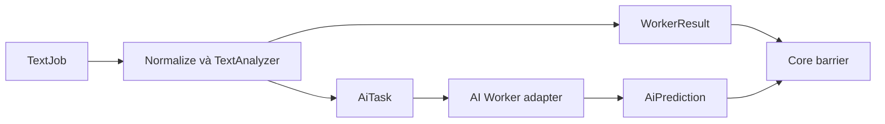

# T-MVP03 · Text extraction, Result Integration và AI runtime handoff — Báo cáo tính năng

## Thông tin chung

| Trường | Giá trị |
|---|---|
| Mã nhóm tính năng | T-MVP03 |
| Tên nhóm | Text extraction, Result Integration và AI runtime handoff |
| Người thực hiện | Thắng |
| Người review chéo | Kiên theo phân công; không thay xác nhận cá nhân |
| Thành phần | Web / Core / Worker theo phạm vi bên dưới |
| Tuần / Sprint | W11 · 13/10–19/10/2026; Sprint chưa xác nhận |
| Mốc kiến trúc | V3.3; không suy ra quyết định nhóm đã approve |
| Pull Request / Commit | Bảng truy vết ở dưới |
| Trạng thái | Báo cáo bổ sung hồi cứu; trạng thái code theo từng PR, chưa nhận nghiệm thu |
| Ngày nộp báo cáo | Soạn 29/10/2026; chờ review PR tài liệu |

---

## 1. Tóm tắt trong 30 giây

- **Tôi đã làm gì:** TextAnalyzer, entity extraction URL/phone/bank có cue; Java Text Worker AMQP, AI task/prediction handoff và adapter intake. Timeline T-MVP03 nhấn QR/VietQR; task W11 nhấn Text/Result/AI, nên ghi rõ phần QR nested được hoàn thiện ở PR W12.
- **Ai dùng ngay:** các thành viên đọc contract/runbook để tích hợp hoặc review theo phạm vi.
- **Chạy thử nhanh nhất:** xem mục 11; fixture không thay E2E.

---

## 2. Phạm vi đã làm

### 2.1. Đã hoàn thành ở mức có bằng chứng

| Ưu tiên | Tính năng | Bằng chứng |
|---|---|---|
| P0/P1 theo task | TextAnalyzer xuất cues/scenarios và derived indicators có giới hạn, không fetch URL. | [Spec triển khai](https://github.com/KLTN-2023-HCMSU/Scam-Risk-Detector/blob/0fe194976260bba5b7d82553ee0d51a5b644fa7c/docs/specs/S02_text_analysis_integration.md) · [Hồ sơ kiểm chứng](https://github.com/KLTN-2023-HCMSU/Scam-Risk-Detector/blob/0fe194976260bba5b7d82553ee0d51a5b644fa7c/docs/specs/E-AI_text_worker.md) |
| P0/P1 theo task | Text Worker publish-confirm/ACK và task identity ổn định qua retry. | [Spec triển khai](https://github.com/KLTN-2023-HCMSU/Scam-Risk-Detector/blob/0fe194976260bba5b7d82553ee0d51a5b644fa7c/docs/specs/S02_text_analysis_integration.md) · [Hồ sơ kiểm chứng](https://github.com/KLTN-2023-HCMSU/Scam-Risk-Detector/blob/0fe194976260bba5b7d82553ee0d51a5b644fa7c/docs/specs/E-AI_text_worker.md) |
| P0/P1 theo task | Có AI adapter/QA harness và success/failure paths theo hợp đồng; không nhúng provider vào Web hoặc text normalizer. | [Spec triển khai](https://github.com/KLTN-2023-HCMSU/Scam-Risk-Detector/blob/0fe194976260bba5b7d82553ee0d51a5b644fa7c/docs/specs/S02_text_analysis_integration.md) · [Hồ sơ kiểm chứng](https://github.com/KLTN-2023-HCMSU/Scam-Risk-Detector/blob/0fe194976260bba5b7d82553ee0d51a5b644fa7c/docs/specs/E-AI_text_worker.md) |

### 2.2. Chưa hoàn tất / không thuộc snapshot

Không nhận QR parent-child E2E, result ownership API thật hoặc live model là đã nghiệm thu W11. Các spec đầu kỳ ghi rõ còn chờ Core read contract; phần tích hợp hoàn tất tiếp trong W12.

[Task tuần](../../../tasks/W11/Thang.md)

---

## 3. Hợp đồng API

POST /v1/scans/text theo adapter W09 intake ở snapshot này: max 5000, không source, bắt buộc Idempotency-Key; receipt accepted/replayed chưa phải final result. AiTask/AiPrediction qua RabbitMQ, không HTTP scoring API public cho Web.

**Input minh họa, không có dữ liệu người dùng thật:**

```json
{"text":"Canh bao cung cap OTP gap","contentType":"MESSAGE"}
```

**Output/đường lỗi:** TextWorkerResult signals + derivedIndicators + pendingAiTasks; AI trả prediction đúng schema. Core giữ quyền tạo final risk score/verdict. Validation/quyền/phụ thuộc phải đọc theo OpenAPI của đúng snapshot, không suy từ ví dụ thành contract mới.

[OpenAPI hiện tại](https://github.com/KLTN-2023-HCMSU/Scam-Risk-Detector/blob/0fe194976260bba5b7d82553ee0d51a5b644fa7c/contracts/openapi/anti-scam-api.yaml); đối chiếu spec lịch sử nếu chạy PR cũ.

---

## 4. Mô hình dữ liệu

Worker không truy cập Core DB/Redis. Phần persistence/barrier là ownership của Core; không tự tạo DB trong Text Worker để giải quyết handoff.

---

## 5. Luồng xử lý



Nhánh lỗi và giới hạn: Không nhận QR parent-child E2E, result ownership API thật hoặc live model là đã nghiệm thu W11. Các spec đầu kỳ ghi rõ còn chờ Core read contract; phần tích hợp hoàn tất tiếp trong W12.

---

## 6. Cấu trúc mã nguồn

| Điểm vào / File | Trách nhiệm |
|---|---|
| [docs/specs/S02_text_analysis_integration.md](https://github.com/KLTN-2023-HCMSU/Scam-Risk-Detector/blob/0fe194976260bba5b7d82553ee0d51a5b644fa7c/docs/specs/S02_text_analysis_integration.md) | Cues/extraction, bridge intake và kết quả xác minh Text/AI |
| [docs/specs/S02_text_worker_runtime.md](https://github.com/KLTN-2023-HCMSU/Scam-Risk-Detector/blob/0fe194976260bba5b7d82553ee0d51a5b644fa7c/docs/specs/S02_text_worker_runtime.md) | Worker entrypoint, AMQP lifecycle và handoff runtime |
| [docs/specs/E-AI_text_worker.md](https://github.com/KLTN-2023-HCMSU/Scam-Risk-Detector/blob/0fe194976260bba5b7d82553ee0d51a5b644fa7c/docs/specs/E-AI_text_worker.md) | AI provider adapter, schemas, timeout/failure và QA harness |
| [services/ai-worker/requirements.txt](https://github.com/KLTN-2023-HCMSU/Scam-Risk-Detector/blob/0fe194976260bba5b7d82553ee0d51a5b644fa7c/services/ai-worker/requirements.txt) | Dependency Python được dùng để dựng AI Worker |

Link code ở báo cáo này ghim tại `0fe194976260` để không thay đổi âm thầm. Spec lịch sử ghi snapshot cũ riêng; không nhận file hiện tại đã tồn tại nguyên trạng tại mọi tuần.

---

## 7. Quyết định kỹ thuật và đánh đổi

AI bất đồng bộ với taskId/deadline và publish-before-pending để không công bố task chưa phát thành công; đổi lại Core cần barrier/dedup và degraded fallback.

Không có biên bản bổ sung phê duyệt DEC của cả nhóm/giảng viên; chỉ ghi lý do implementation và yêu cầu owner đã có. Xem nguồn kiến trúc thay vì tạo bản sao business rules.

---

## 8. Cấu hình và biến môi trường

TEXT_WORKER_BANK_CODES, TEXT_WORKER_AI_ENABLED (mặc định false), Rabbit credentials ngoài Git; cấu hình provider/model theo môi trường. Không đưa key/model từ project khác vào hệ thống.

Cài dependency theo Maven wrapper/npm lockfile/requirements của repo code. Không chép .env, token, key hoặc thông tin đăng nhập vào document.

---

## 9. Bảo mật và quyền riêng tư

| Rủi ro | Xử lý / giới hạn |
|---|---|
| Nội dung riêng tư | Không log raw text/định danh/token; dùng dữ liệu thử có kiểm soát |
| Worker vượt quyền | Worker trả facts/signals, Core quyết định score/owner/lifecycle |
| UI/XSS và kết luận an toàn | Text binding, không suy ra SAFE khi thiếu verdict; phạm vi kiểm thử theo BCKT |

[Business Rules chuẩn](https://github.com/KLTN-2023-HCMSU/Scam-Risk-Detector/blob/0fe194976260bba5b7d82553ee0d51a5b644fa7c/docs/business-rules.md)

---

## 10. Kiểm thử

Spec integration lịch sử ghi TextAnalyzer/TextRabbitWorker 11/11; AI sandbox 19 PASS, broker chạy riêng. Java tổng 117 discovered/115 PASS/2 opt-in skipped trong snapshot đó. Không đồng nhất sandbox với live provider.

[Báo cáo kiểm thử theo Template 04](BCKT_T-MVP03_Text_Extraction_AI_Runtime_Thang.md) · [Spec triển khai](https://github.com/KLTN-2023-HCMSU/Scam-Risk-Detector/blob/0fe194976260bba5b7d82553ee0d51a5b644fa7c/docs/specs/S02_text_analysis_integration.md) · [Hồ sơ kiểm chứng](https://github.com/KLTN-2023-HCMSU/Scam-Risk-Detector/blob/0fe194976260bba5b7d82553ee0d51a5b644fa7c/docs/specs/E-AI_text_worker.md)

---

## 11. Cách chạy thử / demo

Tại checkout **repo code** phù hợp với PR/snapshot, không chạy lệnh ứng dụng trong repo document:

```bash
cd services/api
./mvnw test
# AI worker: cài services/ai-worker/requirements.txt và chạy theo E-AI spec
```

Không áp dụng screenshot UI riêng — phạm vi runtime/worker, xem sơ đồ và log được dẫn trong spec.

Ảnh/fixture lịch sử không chứng minh mọi ca backend hoặc môi trường phát hành đang hoạt động.

---

## 12. Ảnh hưởng tới người khác

| Với ai | Nội dung cần bàn giao | Xác nhận |
|---|---|---|
| Kiên | Review contract/Core/quyền và kiểm thử chéo đúng snapshot | Chưa tự điền approve |
| Khải / nhóm runtime | Queue/schema/config/browser theo phần có ảnh hưởng | Xem handoff trong spec, chưa tự nhận đã thông báo |
| Nhóm / giảng viên | Phân biệt implemented, merged và accepted | Báo cáo này không phải biên bản nghiệm thu |

---

## 13. Hạn chế đã biết và việc còn nợ

Không nhận QR parent-child E2E, result ownership API thật hoặc live model là đã nghiệm thu W11. Các spec đầu kỳ ghi rõ còn chờ Core read contract; phần tích hợp hoàn tất tiếp trong W12.

Chưa ghi nhận giờ làm thực tế, review cá nhân, thời điểm hoàn thành từng hạng mục hoặc chữ ký UAT. Không công bố accuracy/latency/F1 từ unit test.

---

## 14. Nhật ký thay đổi

| Ngày | Nội dung |
|---|---|
| 29/10/2026 | Bổ sung hồi cứu theo Template 01, không nhận đã nộp đúng hạn |

| PR | Trạng thái GitHub tại lúc kiểm tra | Thời điểm merge UTC | Head snapshot |
|---|---|---|---|
| [#11](https://github.com/KLTN-2023-HCMSU/Scam-Risk-Detector/pull/11) | MERGED | 2026-10-20T02:29:37Z | `bccc373bb806` |

Ngày merge không phải ngày code hoàn thành. Báo cáo tuần không lấy trạng thái hiện tại gán ngược cho hạn cuối tuần.
