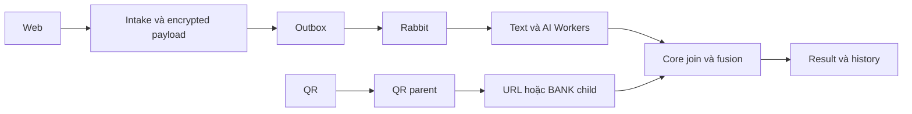

# T-MVP04 · Text Scan, QR/VietQR, AI, History và Export — Báo cáo tính năng

## Thông tin chung

| Trường | Giá trị |
|---|---|
| Mã nhóm tính năng | T-MVP04 |
| Tên nhóm | Text Scan, QR/VietQR, AI, History và Export |
| Người thực hiện | Thắng |
| Người review chéo | Kiên theo phân công; không thay xác nhận cá nhân |
| Thành phần | Web / Core / Worker theo phạm vi bên dưới |
| Tuần / Sprint | W12 · 20/10–26/10/2026; Sprint chưa xác nhận |
| Mốc kiến trúc | V3.3; không suy ra quyết định nhóm đã approve |
| Pull Request / Commit | Bảng truy vết ở dưới |
| Trạng thái | Báo cáo bổ sung hồi cứu; trạng thái code theo từng PR, chưa nhận nghiệm thu |
| Ngày nộp báo cáo | Soạn 29/10/2026; chờ review PR tài liệu |

---

## 1. Tóm tắt trong 30 giây

- **Tôi đã làm gì:** Phân công W12 chủ sở hữu cung cấp: S02 Text E2E, S05 QR/VietQR nested, E-AI RabbitMQ, R03 History và R04 PDF/HTML. Dùng V3.3 document defaults và dữ liệu ngân hàng synthetic cho QA, không nhận source/provider thật.
- **Ai dùng ngay:** các thành viên đọc contract/runbook để tích hợp hoặc review theo phạm vi.
- **Chạy thử nhanh nhất:** xem mục 11; fixture không thay E2E.

---

## 2. Phạm vi đã làm

### 2.1. Đã hoàn thành ở mức có bằng chứng

| Ưu tiên | Tính năng | Bằng chứng |
|---|---|---|
| P0/P1 theo task | Text Worker → AI Worker → Core được thử trong stack HTTP/Redis/PostgreSQL/Rabbit local thực với provider synthetic. | [Spec triển khai](https://github.com/KLTN-2023-HCMSU/Scam-Risk-Detector/blob/0fe194976260bba5b7d82553ee0d51a5b644fa7c/docs/specs/T-W12_text_qr_ai_history_export.md) · [Hồ sơ kiểm chứng](https://github.com/KLTN-2023-HCMSU/Scam-Risk-Detector/blob/0fe194976260bba5b7d82553ee0d51a5b644fa7c/docs/specs/T-W12_text_qr_ai_history_export.md) |
| P0/P1 theo task | QR URL/VietQR có parent-child scan, owner isolation và idempotent replay. | [Spec triển khai](https://github.com/KLTN-2023-HCMSU/Scam-Risk-Detector/blob/0fe194976260bba5b7d82553ee0d51a5b644fa7c/docs/specs/T-W12_text_qr_ai_history_export.md) · [Hồ sơ kiểm chứng](https://github.com/KLTN-2023-HCMSU/Scam-Risk-Detector/blob/0fe194976260bba5b7d82553ee0d51a5b644fa7c/docs/specs/T-W12_text_qr_ai_history_export.md) |
| P0/P1 theo task | History có filter/paging theo owner; result có HMAC report proof, verifier và bản in HTML/A4. | [Spec triển khai](https://github.com/KLTN-2023-HCMSU/Scam-Risk-Detector/blob/0fe194976260bba5b7d82553ee0d51a5b644fa7c/docs/specs/T-W12_text_qr_ai_history_export.md) · [Hồ sơ kiểm chứng](https://github.com/KLTN-2023-HCMSU/Scam-Risk-Detector/blob/0fe194976260bba5b7d82553ee0d51a5b644fa7c/docs/specs/T-W12_text_qr_ai_history_export.md) |

### 2.2. Chưa hoàn tất / không thuộc snapshot

PR #24 còn mở, chưa merge và chưa có Kiên sign-off/G4. Live provider/nguồn ngân hàng thực và shared staging không được chứng minh bằng QA synthetic. PHONE được bổ sung sau trong W13 theo yêu cầu riêng.

Phân công W12 do chủ sở hữu cung cấp trong quá trình làm việc; repo document chưa có task tương ứng, cần lead xác nhận cùng [timeline](../../../plan/v2.1/Timeline_full_Anti_Scam_2026_2027_V2.1.md).

---

## 3. Hợp đồng API

POST /v1/scans/text, /v1/scans/qr, /v1/scans/entity (BANK_ACCOUNT ở snapshot W12); GET /v1/scans/{scanId}, /result, /report-proof, /history và /qr/{scanId}/child; POST /v1/scans/reports/verify. Read/issuance theo owner; foreign result trả 404.

**Input minh họa, không có dữ liệu người dùng thật:**

```json
{"text":"Canh bao tai khoan bi khoa, cung cap OTP","contentType":"MESSAGE"}
```

**Output/đường lỗi:** POST trả 202 với data.accepted/replayed/scanId; poll đến COMPLETED rồi đọc canonical result. RiskResult có score/level/evidence/degraded/policyVersion, không trả raw input. Validation/quyền/phụ thuộc phải đọc theo OpenAPI của đúng snapshot, không suy từ ví dụ thành contract mới.

[OpenAPI hiện tại](https://github.com/KLTN-2023-HCMSU/Scam-Risk-Detector/blob/0fe194976260bba5b7d82553ee0d51a5b644fa7c/contracts/openapi/anti-scam-api.yaml); đối chiếu spec lịch sử nếu chạy PR cũ.

---

## 4. Mô hình dữ liệu

Core lưu scan_requests/outbox_events/scan_results/scan_signals/scan_ai_progress; QR parent-child và M08 observations. Dữ liệu nhạy cảm mã hóa, lookup HMAC. Trong bản tích hợp dev mới: giữ V9 auth và dùng V12 AI; không áp schema QA V9 AI cũ lên DB dùng chung.

---

## 5. Luồng xử lý



Nhánh lỗi và giới hạn: PR #24 còn mở, chưa merge và chưa có Kiên sign-off/G4. Live provider/nguồn ngân hàng thực và shared staging không được chứng minh bằng QA synthetic. PHONE được bổ sung sau trong W13 theo yêu cầu riêng.

---

## 6. Cấu trúc mã nguồn

| Điểm vào / File | Trách nhiệm |
|---|---|
| [docs/specs/T-W12_text_qr_ai_history_export.md](https://github.com/KLTN-2023-HCMSU/Scam-Risk-Detector/blob/0fe194976260bba5b7d82553ee0d51a5b644fa7c/docs/specs/T-W12_text_qr_ai_history_export.md) | Phạm vi và tiêu chí Text/QR/AI/History/Export W12 |
| [apps/web/src/components/scan/QrImageScan.tsx](https://github.com/KLTN-2023-HCMSU/Scam-Risk-Detector/blob/0fe194976260bba5b7d82553ee0d51a5b644fa7c/apps/web/src/components/scan/QrImageScan.tsx) | Đọc QR trên trình duyệt, validate file/payload và gửi nested scan |
| [apps/web/src/components/scan/ScanHistory.tsx](https://github.com/KLTN-2023-HCMSU/Scam-Risk-Detector/blob/0fe194976260bba5b7d82553ee0d51a5b644fa7c/apps/web/src/components/scan/ScanHistory.tsx) | Lọc/phân trang lịch sử và loại bỏ dữ liệu thuộc phiên cũ |
| [apps/web/src/components/scan/ScanPrintReport.tsx](https://github.com/KLTN-2023-HCMSU/Scam-Risk-Detector/blob/0fe194976260bba5b7d82553ee0d51a5b644fa7c/apps/web/src/components/scan/ScanPrintReport.tsx) | Bố cục bản in, hash client và proof server theo scan/phiên hiện tại |
| [services/api/src/main/java/com/antiscam/api/scan/api/ScanReportVerificationController.java](https://github.com/KLTN-2023-HCMSU/Scam-Risk-Detector/blob/0fe194976260bba5b7d82553ee0d51a5b644fa7c/services/api/src/main/java/com/antiscam/api/scan/api/ScanReportVerificationController.java) | Cấp proof theo owner và kiểm tra code/canonical result |

Link code ở báo cáo này ghim tại `0fe194976260` để không thay đổi âm thầm. Spec lịch sử ghi snapshot cũ riêng; không nhận file hiện tại đã tồn tại nguyên trạng tại mọi tuần.

---

## 7. Quyết định kỹ thuật và đánh đổi

QR giải mã trên client, Core điều phối child; HMAC proof xác thực canonical result, không chứng thực byte PDF. Dùng trọng số V3.3 mặc định theo yêu cầu owner, không coi là calibrated production policy.

Không có biên bản bổ sung phê duyệt DEC của cả nhóm/giảng viên; chỉ ghi lý do implementation và yêu cầu owner đã có. Xem nguồn kiến trúc thay vì tạo bản sao business rules.

---

## 8. Cấu hình và biến môi trường

CORE_DOCUMENT_POLICY_ENABLED; SCAN_MESSAGING_ENABLED; SCAN_PAYLOAD_ENCRYPTION_KEY; SCAN_REPORT_VERIFICATION_KEY; BANK_REPUTATION_MODE. Chỉ QA cô lập mới bật synthetic theo guard; secrets không nằm trong báo cáo.

Cài dependency theo Maven wrapper/npm lockfile/requirements của repo code. Không chép .env, token, key hoặc thông tin đăng nhập vào document.

---

## 9. Bảo mật và quyền riêng tư

| Rủi ro | Xử lý / giới hạn |
|---|---|
| Nội dung riêng tư | Không log raw text/định danh/token; dùng dữ liệu thử có kiểm soát |
| Worker vượt quyền | Worker trả facts/signals, Core quyết định score/owner/lifecycle |
| UI/XSS và kết luận an toàn | Text binding, không suy ra SAFE khi thiếu verdict; phạm vi kiểm thử theo BCKT |

[Business Rules chuẩn](https://github.com/KLTN-2023-HCMSU/Scam-Risk-Detector/blob/0fe194976260bba5b7d82553ee0d51a5b644fa7c/docs/business-rules.md)

---

## 10. Kiểm thử

W12 spec ghi Java 256 tổng/0 failure/0 error/15 opt-in skipped ở lượt cuối; unit/fixture và PostgreSQL/broker E2E được phân biệt riêng. Không nhận các số đó là test count của commit W13 mới.

[Báo cáo kiểm thử theo Template 04](BCKT_T-MVP04_Text_QR_AI_History_Export_Thang.md) · [Spec triển khai](https://github.com/KLTN-2023-HCMSU/Scam-Risk-Detector/blob/0fe194976260bba5b7d82553ee0d51a5b644fa7c/docs/specs/T-W12_text_qr_ai_history_export.md) · [Hồ sơ kiểm chứng](https://github.com/KLTN-2023-HCMSU/Scam-Risk-Detector/blob/0fe194976260bba5b7d82553ee0d51a5b644fa7c/docs/specs/T-W12_text_qr_ai_history_export.md)

---

## 11. Cách chạy thử / demo

Tại checkout **repo code** phù hợp với PR/snapshot, không chạy lệnh ứng dụng trong repo document:

```bash
python scripts/qa-w12-stack.py
# Cần PostgreSQL/Redis/Rabbit local và Python dependencies theo W12 spec; chỉ dùng DB/vhost tạm
```


Ảnh/fixture lịch sử không chứng minh mọi ca backend hoặc môi trường phát hành đang hoạt động.

---

## 12. Ảnh hưởng tới người khác

| Với ai | Nội dung cần bàn giao | Xác nhận |
|---|---|---|
| Kiên | Review contract/Core/quyền và kiểm thử chéo đúng snapshot | Chưa tự điền approve |
| Khải / nhóm runtime | Queue/schema/config/browser theo phần có ảnh hưởng | Xem handoff trong spec, chưa tự nhận đã thông báo |
| Nhóm / giảng viên | Phân biệt implemented, merged và accepted | Báo cáo này không phải biên bản nghiệm thu |

---

## 13. Hạn chế đã biết và việc còn nợ

PR #24 còn mở, chưa merge và chưa có Kiên sign-off/G4. Live provider/nguồn ngân hàng thực và shared staging không được chứng minh bằng QA synthetic. PHONE được bổ sung sau trong W13 theo yêu cầu riêng.

Chưa ghi nhận giờ làm thực tế, review cá nhân, thời điểm hoàn thành từng hạng mục hoặc chữ ký UAT. Không công bố accuracy/latency/F1 từ unit test.

---

## 14. Nhật ký thay đổi

| Ngày | Nội dung |
|---|---|
| 29/10/2026 | Bổ sung hồi cứu theo Template 01, không nhận đã nộp đúng hạn |

| PR | Trạng thái GitHub tại lúc kiểm tra | Thời điểm merge UTC | Head snapshot |
|---|---|---|---|
| [#24](https://github.com/KLTN-2023-HCMSU/Scam-Risk-Detector/pull/24) | OPEN | Chưa merge | `25d42a106234` |

Ngày merge không phải ngày code hoàn thành. Báo cáo tuần không lấy trạng thái hiện tại gán ngược cho hạn cuối tuần.
