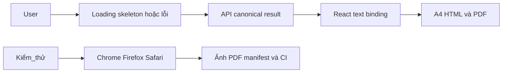

# T-W13 · UI/UX Audit, XSS, PDF và Live Demo — Báo cáo tính năng

## Thông tin chung

| Trường | Giá trị |
|---|---|
| Mã nhóm tính năng | T-W13 |
| Tên nhóm | UI/UX Audit, XSS, PDF và Live Demo |
| Người thực hiện | Thắng |
| Người review chéo | Kiên theo phân công; không thay xác nhận cá nhân |
| Thành phần | Web / Core / Worker theo phạm vi bên dưới |
| Tuần / Sprint | W13 · 27/10–02/11/2026; Sprint chưa xác nhận |
| Mốc kiến trúc | V3.3; không suy ra quyết định nhóm đã approve |
| Pull Request / Commit | Bảng truy vết ở dưới |
| Trạng thái | Báo cáo bổ sung hồi cứu; trạng thái code theo từng PR, chưa nhận nghiệm thu |
| Ngày nộp báo cáo | Soạn 29/10/2026; chờ review PR tài liệu |

---

## 1. Tóm tắt trong 30 giây

- **Tôi đã làm gì:** UI-REG01, SEC-UI01, EXP-01, DEMO-RUN theo yêu cầu W13 chủ sở hữu cung cấp. PHONE và Docker HTTPS local là phần bổ sung được owner yêu cầu sau freeze; không biến VPS/public staging thành DoD W13.
- **Ai dùng ngay:** các thành viên đọc contract/runbook để tích hợp hoặc review theo phạm vi.
- **Chạy thử nhanh nhất:** xem mục 11; fixture không thay E2E.

---

## 2. Phạm vi đã làm

### 2.1. Đã hoàn thành ở mức có bằng chứng

| Ưu tiên | Tính năng | Bằng chứng |
|---|---|---|
| P0/P1 theo task | Thêm skeleton Result Detail, trạng thái ARIA và reduced-motion; chỉnh nhãn/dấu bản in Safari. | [Spec triển khai](https://github.com/KLTN-2023-HCMSU/Scam-Risk-Detector/blob/0fe194976260bba5b7d82553ee0d51a5b644fa7c/docs/specs/T-W13_ui_xss_pdf_demo.md) · [Hồ sơ kiểm chứng](https://github.com/KLTN-2023-HCMSU/Scam-Risk-Detector/blob/0fe194976260bba5b7d82553ee0d51a5b644fa7c/docs/specs/T-W13_phone_https_acceptance.md) |
| P0/P1 theo task | Có PDF API thật cho 5 loại và kiểm tra browser/XSS; chạy regression sau đồng bộ dev. | [Spec triển khai](https://github.com/KLTN-2023-HCMSU/Scam-Risk-Detector/blob/0fe194976260bba5b7d82553ee0d51a5b644fa7c/docs/specs/T-W13_ui_xss_pdf_demo.md) · [Hồ sơ kiểm chứng](https://github.com/KLTN-2023-HCMSU/Scam-Risk-Detector/blob/0fe194976260bba5b7d82553ee0d51a5b644fa7c/docs/specs/T-W13_phone_https_acceptance.md) |
| P0/P1 theo task | Có slide HTML 10 trang, demo script 10 phút và bản thảo chương Web/Async AI/UIUX. | [Spec triển khai](https://github.com/KLTN-2023-HCMSU/Scam-Risk-Detector/blob/0fe194976260bba5b7d82553ee0d51a5b644fa7c/docs/specs/T-W13_ui_xss_pdf_demo.md) · [Hồ sơ kiểm chứng](https://github.com/KLTN-2023-HCMSU/Scam-Risk-Detector/blob/0fe194976260bba5b7d82553ee0d51a5b644fa7c/docs/specs/T-W13_phone_https_acceptance.md) |
| P0/P1 theo task | Bổ sung PHONE M08, HTTPS local, TLS/cookie/RBAC/SSRF regression; giữ auth/session/SMTP từ dev khi resolve conflict. | [Spec triển khai](https://github.com/KLTN-2023-HCMSU/Scam-Risk-Detector/blob/0fe194976260bba5b7d82553ee0d51a5b644fa7c/docs/specs/T-W13_ui_xss_pdf_demo.md) · [Hồ sơ kiểm chứng](https://github.com/KLTN-2023-HCMSU/Scam-Risk-Detector/blob/0fe194976260bba5b7d82553ee0d51a5b644fa7c/docs/specs/T-W13_phone_https_acceptance.md) |

### 2.2. Chưa hoàn tất / không thuộc snapshot

Thắng chưa có biên bản tổng duyệt người thật; Kiên chưa ký cross-test; chưa trình diễn/nghiệm thu release. HTTPS local trước đó rule-only, không nhận paid/live AI hay SMTP từ bằng chứng đó. Runtime snapshot sau merge dev có SMTP code, chưa có phép đo live delivery riêng.

Phân công W13 do chủ sở hữu cung cấp trong quá trình làm việc; repo document chưa có task tương ứng, cần lead xác nhận cùng [timeline](../../../plan/v2.1/Timeline_full_Anti_Scam_2026_2027_V2.1.md).

---

## 3. Hợp đồng API

W13 gốc không tạo endpoint mới cho audit. Bổ sung POST /v1/scans/entity cho PHONE dùng DTO có sẵn: nhận số Việt Nam 0…/+84…, không bankCode, canonicalize trước fingerprint; no-data trả CAUTION/degraded. Runtime config HTTPS chỉ phục vụ triển khai/QA.

**Input minh họa, không có dữ liệu người dùng thật:**

```json
{"entityType":"PHONE","value":"0901234567"}
```

**Output/đường lỗi:** 202 → COMPLETED; số QA chưa có nguồn trả CAUTION/degraded, không suy ra SAFE. PDF có thời gian, evidence, hash, proof và dấu tham khảo/giả lập. Validation/quyền/phụ thuộc phải đọc theo OpenAPI của đúng snapshot, không suy từ ví dụ thành contract mới.

[OpenAPI hiện tại](https://github.com/KLTN-2023-HCMSU/Scam-Risk-Detector/blob/0fe194976260bba5b7d82553ee0d51a5b644fa7c/contracts/openapi/anti-scam-api.yaml); đối chiếu spec lịch sử nếu chạy PR cũ.

---

## 4. Mô hình dữ liệu

W13 PHONE dùng M08 và ENTITY outbox hiện có, không tạo DB mới. Bản tích hợp giữ V9 auth, AI dùng V12. Không sửa/xóa dữ liệu hay Flyway history trên môi trường dùng chung.

---

## 5. Luồng xử lý



Nhánh lỗi và giới hạn: Thắng chưa có biên bản tổng duyệt người thật; Kiên chưa ký cross-test; chưa trình diễn/nghiệm thu release. HTTPS local trước đó rule-only, không nhận paid/live AI hay SMTP từ bằng chứng đó. Runtime snapshot sau merge dev có SMTP code, chưa có phép đo live delivery riêng.

---

## 6. Cấu trúc mã nguồn

| Điểm vào / File | Trách nhiệm |
|---|---|
| [apps/web/src/components/risk/ResultDetailView.tsx](https://github.com/KLTN-2023-HCMSU/Scam-Risk-Detector/blob/0fe194976260bba5b7d82553ee0d51a5b644fa7c/apps/web/src/components/risk/ResultDetailView.tsx) | Chọn loading/error/no-data/completed; validate canonical payload trước khi hiện card |
| [apps/web/src/components/scan/ScanPrintReport.tsx](https://github.com/KLTN-2023-HCMSU/Scam-Risk-Detector/blob/0fe194976260bba5b7d82553ee0d51a5b644fa7c/apps/web/src/components/scan/ScanPrintReport.tsx) | Bố cục bản in, hash client và proof server theo scan/phiên hiện tại |
| [services/api/src/main/java/com/antiscam/api/scan/entity/EntityScanProcessor.java](https://github.com/KLTN-2023-HCMSU/Scam-Risk-Detector/blob/0fe194976260bba5b7d82553ee0d51a5b644fa7c/services/api/src/main/java/com/antiscam/api/scan/entity/EntityScanProcessor.java) | Lifecycle ENTITY từ outbox, lookup ngoài write transaction và persist terminal result |
| [services/api/src/main/java/com/antiscam/api/scan/entity/PhoneScanProcessor.java](https://github.com/KLTN-2023-HCMSU/Scam-Risk-Detector/blob/0fe194976260bba5b7d82553ee0d51a5b644fa7c/services/api/src/main/java/com/antiscam/api/scan/entity/PhoneScanProcessor.java) | Gắn PHONE adapter vào Core ENTITY lifecycle |
| [scripts/check-runtime-config.py](https://github.com/KLTN-2023-HCMSU/Scam-Risk-Detector/blob/0fe194976260bba5b7d82553ee0d51a5b644fa7c/scripts/check-runtime-config.py) | Render Compose bằng config tạm và kiểm tra flags, network, TLS/Web isolation |
| [docs/runtime-w13-https.md](https://github.com/KLTN-2023-HCMSU/Scam-Risk-Detector/blob/0fe194976260bba5b7d82553ee0d51a5b644fa7c/docs/runtime-w13-https.md) | Chạy lại HTTPS local, tài khoản QA và giới hạn TLS/provider |

Link code ở báo cáo này ghim tại `0fe194976260` để không thay đổi âm thầm. Spec lịch sử ghi snapshot cũ riêng; không nhận file hiện tại đã tồn tại nguyên trạng tại mọi tuần.

---

## 7. Quyết định kỹ thuật và đánh đổi

Skeleton không tạo risk verdict giả; watermark fixed có stamp normal-flow dự phòng cho Safari. Kiểm thử chéo có thể local; không ép VPS. Giữ migration V9 auth của dev, chuyển AI candidate sang V12 để tránh trùng version; QA schema cũ cần DB mới, không tự repair.

Không có biên bản bổ sung phê duyệt DEC của cả nhóm/giảng viên; chỉ ghi lý do implementation và yêu cầu owner đã có. Xem nguồn kiến trúc thay vì tạo bản sao business rules.

---

## 8. Cấu hình và biến môi trường

PHONE_REPUTATION_ENABLED; STAGING_WEB_ORIGIN và TLS cert paths ngoài Git cho tùy chọn HTTPS. CA chỉ tin trong client/profile QA riêng, acceptInsecureCerts=false. Không tự bật lại các tiến trình đã tắt.

Cài dependency theo Maven wrapper/npm lockfile/requirements của repo code. Không chép .env, token, key hoặc thông tin đăng nhập vào document.

---

## 9. Bảo mật và quyền riêng tư

| Rủi ro | Xử lý / giới hạn |
|---|---|
| Nội dung riêng tư | Không log raw text/định danh/token; dùng dữ liệu thử có kiểm soát |
| Worker vượt quyền | Worker trả facts/signals, Core quyết định score/owner/lifecycle |
| UI/XSS và kết luận an toàn | Text binding, không suy ra SAFE khi thiếu verdict; phạm vi kiểm thử theo BCKT |

[Business Rules chuẩn](https://github.com/KLTN-2023-HCMSU/Scam-Risk-Detector/blob/0fe194976260bba5b7d82553ee0d51a5b644fa7c/docs/business-rules.md)

---

## 10. Kiểm thử

Sau merge dev: Web 219/219 PASS, scripts 20/20 PASS. GitHub CI của 0fe1949: 11/11 checks success, gồm required-ci và Docker/PostgreSQL smoke. Hồ sơ trước merge ghi web 211; giữ đúng source/run, không trộn thành một lần chạy.

[Báo cáo kiểm thử theo Template 04](BCKT_T-W13_UI_XSS_PDF_Demo_Thang.md) · [Spec triển khai](https://github.com/KLTN-2023-HCMSU/Scam-Risk-Detector/blob/0fe194976260bba5b7d82553ee0d51a5b644fa7c/docs/specs/T-W13_ui_xss_pdf_demo.md) · [Hồ sơ kiểm chứng](https://github.com/KLTN-2023-HCMSU/Scam-Risk-Detector/blob/0fe194976260bba5b7d82553ee0d51a5b644fa7c/docs/specs/T-W13_phone_https_acceptance.md)

---

## 11. Cách chạy thử / demo

Tại checkout **repo code** phù hợp với PR/snapshot, không chạy lệnh ứng dụng trong repo document:

```bash
cd apps/web
npm ci
npm test -- --reporter=dot
npm run lint
npm run typecheck
npm run build
# Root: python3 -m unittest discover -s scripts/tests -v
```


Ảnh/fixture lịch sử không chứng minh mọi ca backend hoặc môi trường phát hành đang hoạt động.

---

## 12. Ảnh hưởng tới người khác

| Với ai | Nội dung cần bàn giao | Xác nhận |
|---|---|---|
| Kiên | Review contract/Core/quyền và kiểm thử chéo đúng snapshot | Chưa tự điền approve |
| Khải / nhóm runtime | Queue/schema/config/browser theo phần có ảnh hưởng | Xem handoff trong spec, chưa tự nhận đã thông báo |
| Nhóm / giảng viên | Phân biệt implemented, merged và accepted | Báo cáo này không phải biên bản nghiệm thu |

---

## 13. Hạn chế đã biết và việc còn nợ

Thắng chưa có biên bản tổng duyệt người thật; Kiên chưa ký cross-test; chưa trình diễn/nghiệm thu release. HTTPS local trước đó rule-only, không nhận paid/live AI hay SMTP từ bằng chứng đó. Runtime snapshot sau merge dev có SMTP code, chưa có phép đo live delivery riêng.

Chưa ghi nhận giờ làm thực tế, review cá nhân, thời điểm hoàn thành từng hạng mục hoặc chữ ký UAT. Không công bố accuracy/latency/F1 từ unit test.

---

## 14. Nhật ký thay đổi

| Ngày | Nội dung |
|---|---|
| 29/10/2026 | Bổ sung hồi cứu theo Template 01, không nhận đã nộp đúng hạn |

| PR | Trạng thái GitHub tại lúc kiểm tra | Thời điểm merge UTC | Head snapshot |
|---|---|---|---|
| [#26](https://github.com/KLTN-2023-HCMSU/Scam-Risk-Detector/pull/26) | OPEN | Chưa merge | `0fe194976260` |

Ngày merge không phải ngày code hoàn thành. Báo cáo tuần không lấy trạng thái hiện tại gán ngược cho hạn cuối tuần.
